# Tenet t7 dash

📣 Telegram-канал проекта: [@tenet_t7_dash](https://t.me/tenet_t7_dash) — новости, релизы, обсуждение.
Бот канала (анонсы, отложенные посты, модерация): [docs/telegram-bot.md](docs/telegram-bot.md).

Дашборд-лаунчер для головного устройства автомобиля (Android-мультимедиа).
Рисует домашний экран из настраиваемых «плиток»: часы, погода, состояние
автомобиля, музыка, навигатор и другое. Написан под штатное ГУ на
Android 9 (API 28), устанавливается сайдлоадом (вне Google Play).

> ## ⚠️ Проект полностью создан искусственным интеллектом
> Весь код этого репозитория сгенерирован ИИ. Автор **не несёт никакой
> ответственности** за работу, возможные сбои, повреждение данных, системы
> автомобиля или иные последствия использования. Применяйте на свой страх и
> риск, только на своём устройстве и с полным пониманием действий.

## Скриншоты

Главный экран:

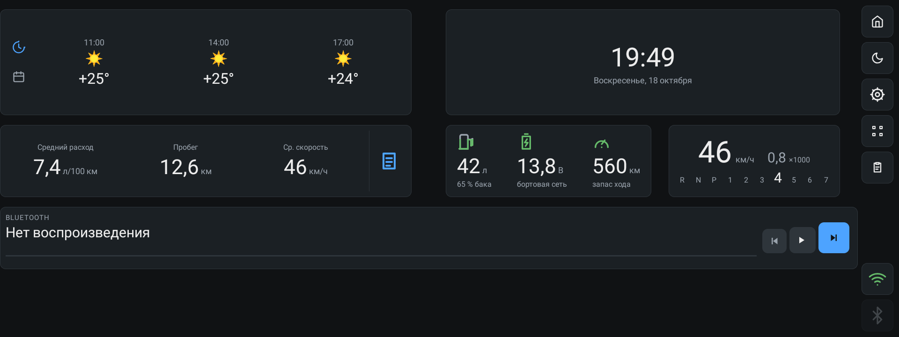

С навигатором, Яндекс Музыкой (спектр), бортовым компьютером и климатом:

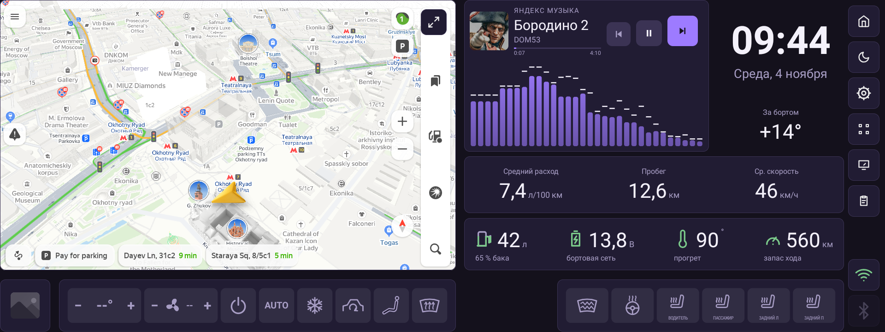

| Добавление блока | Настройки | Тема оформления |
| --- | --- | --- |
| 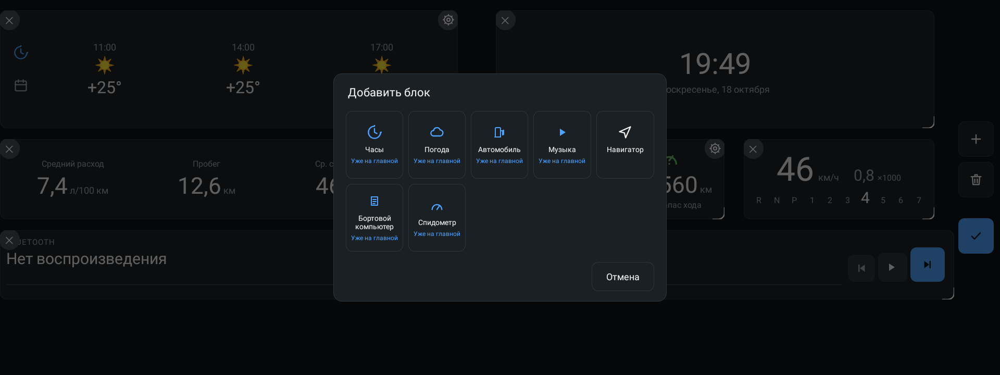 | 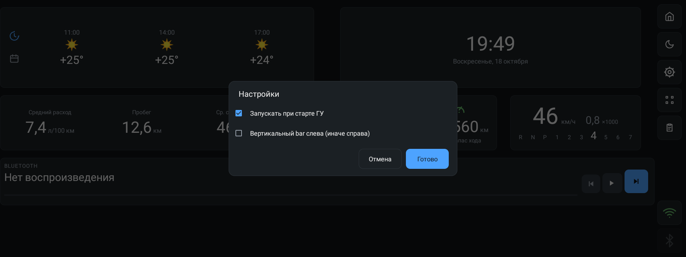 | 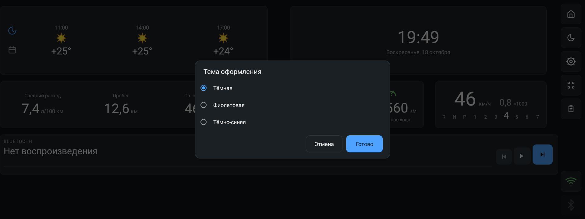 |

Журнал поездок (открывается тапом по «Бортовому компьютеру»): группировка по
дням с итогами, дата с днём недели:

| Журнал поездок | Страница дальше — по датам |
| --- | --- |
| 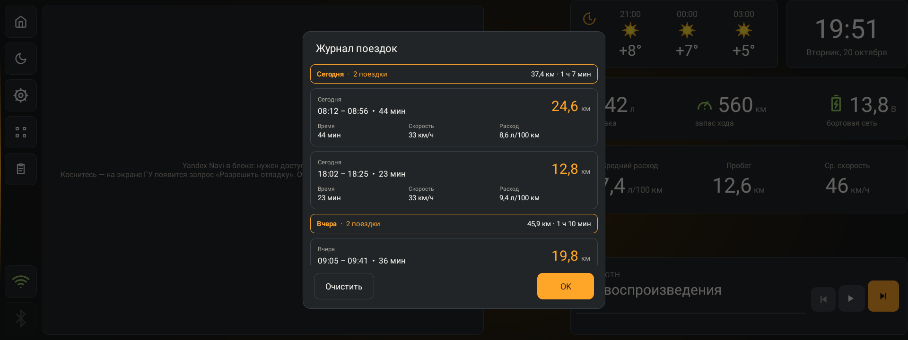 | 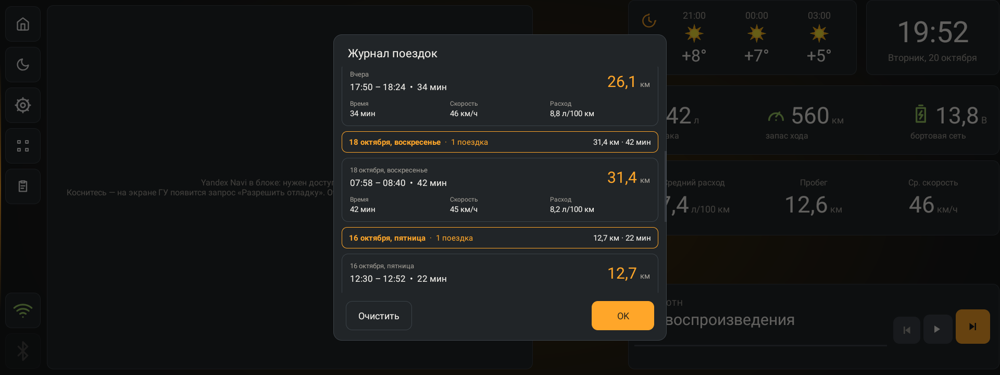 |

Ретро-спидометр на экране ГУ и дашборд с навигатором в машине:

| Ретро-спидометр | Дашборд с навигатором |
| --- | --- |
| 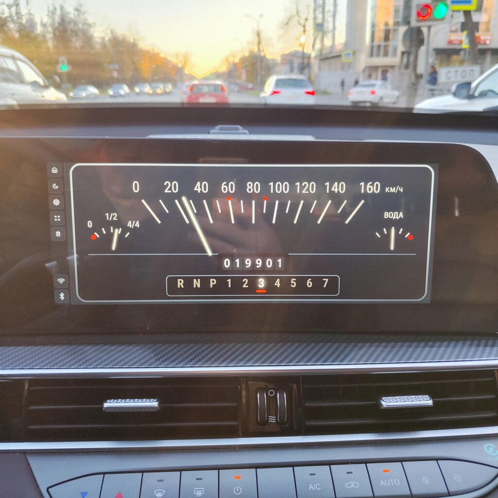 | 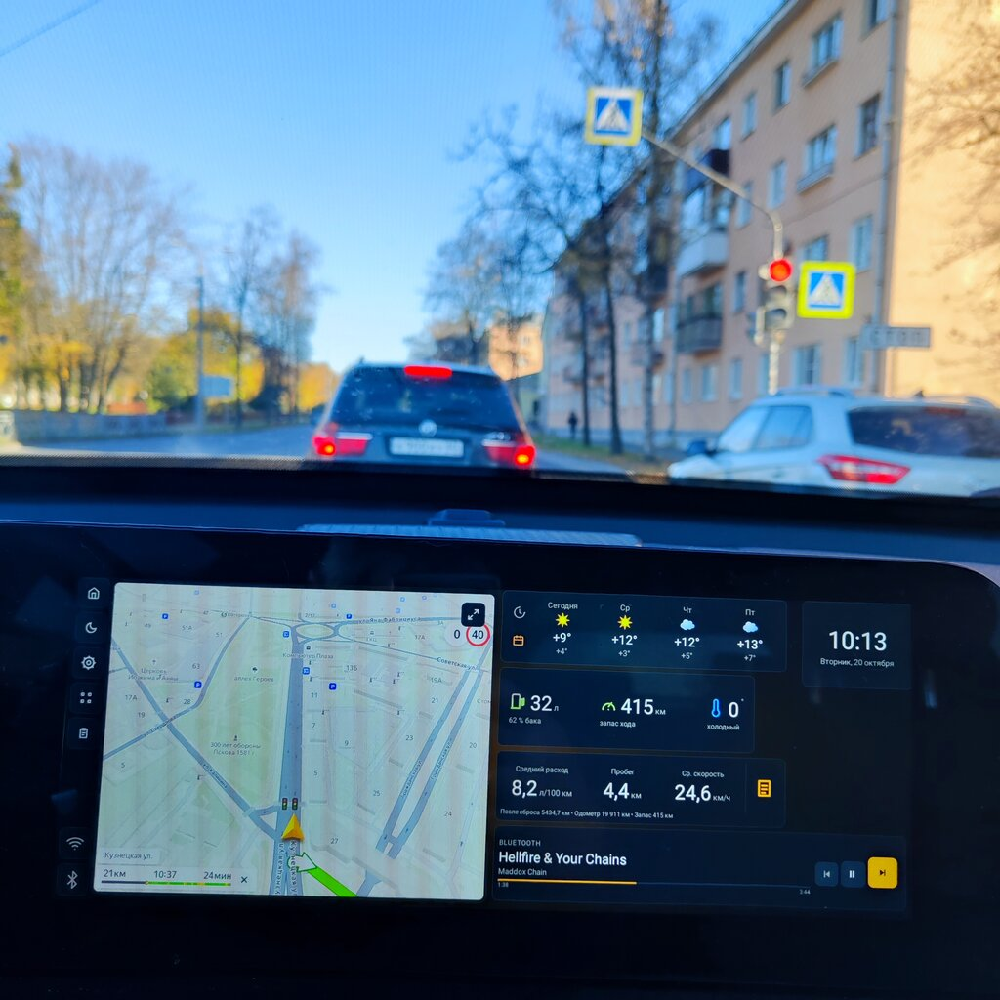 |

Вид «Ретро» у виджетов (настройки блока → «Вид»): чёрные таблички в
металлической рамке, надписи «лампами»:

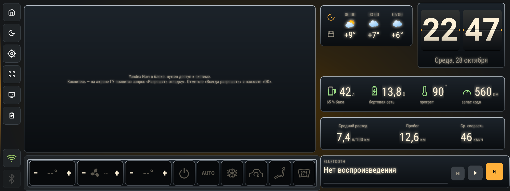

Заставка по простою (подробнее — [docs/screensaver.md](docs/screensaver.md)):

| Тёмный с часами | Камин | Северное сияние |
| --- | --- | --- |
|  | 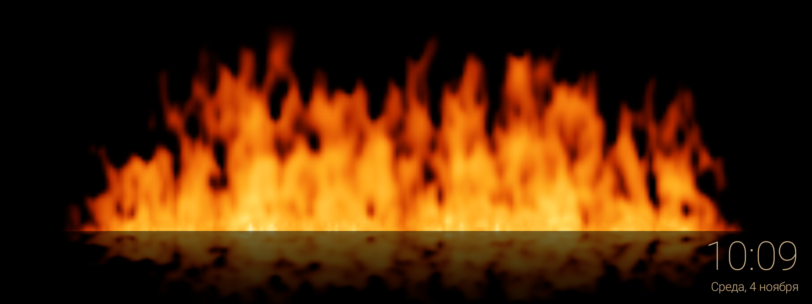 |  |

Управление климатом (подробнее — [docs/climate-control.md](docs/climate-control.md)):

| Классическая тема | Ретро |
| --- | --- |
| 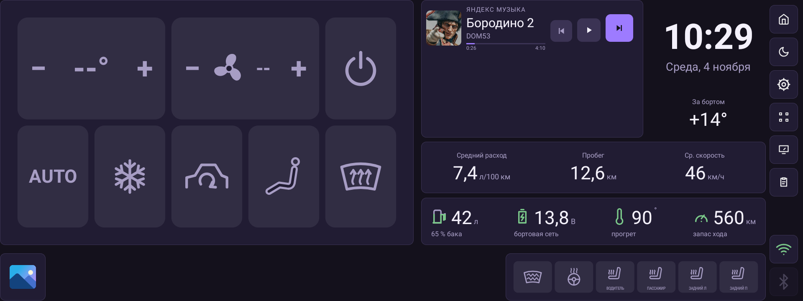 | 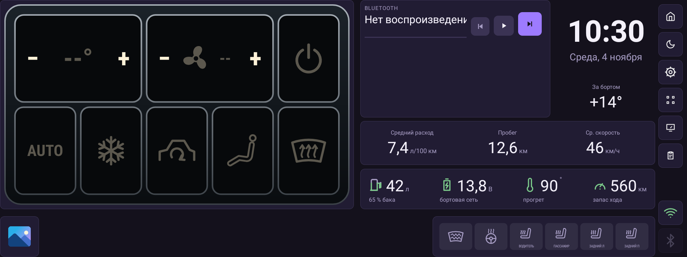 |

Погода (подробнее — [docs/weather.md](docs/weather.md)):

| По часам | По дням |
| --- | --- |
| 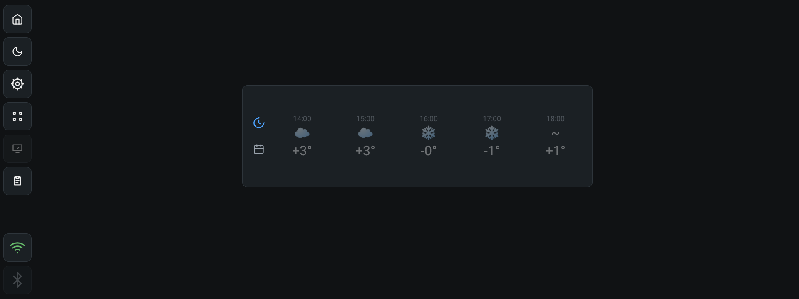 | 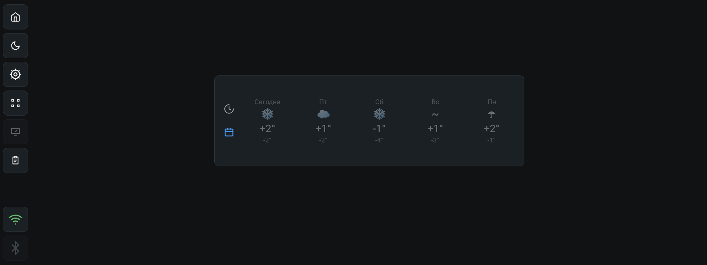 |

## Возможности

- Сетка виджетов 100×70 клеток: перетаскивание, изменение размера, добавление и
  удаление прямо на главном экране (режим редактирования).
- Три темы оформления: тёмная, фиолетовая, тёмно-синяя.
- Вертикальная панель быстрых кнопок (домой, ночь, тема, редактирование,
  журнал, Wi-Fi, Bluetooth), с настройкой стороны — слева или справа.
- Автозапуск при старте ГУ: прошивка режет `BOOT_COMPLETED`, поэтому дашборд
  поднимают привязкой системных служб (слушатель уведомлений и службы
  специальных возможностей). Включается в настройках — приложение само
  выдаёт себе доступ к уведомлениям.
- Приборка — три режима кнопкой на боковой панели: сам Яндекс Навигатор
  на приборке, наша карточка ведения по маршруту, ничего (см. «Интеграция
  с автомобилем»).
- Привязка к штатным данным: подписка на шину Desay SV, VHAL, приборную панель.

## Виджеты

| Виджет | Описание |
| --- | --- |
| Часы | Время и дата: цифровые или перевёртывающиеся часы. |
| [Погода](docs/weather.md) | Прогноз по часам и по дням, переключается иконками слева; число дней и часов настраивается, °C/°F. |
| Автомобиль | Топливо, АКБ, запас хода, селектор, наружная температура. |
| Климат | Только показывает состояние климата: температуры водителя и пассажира, вентилятор, режим, AUTO, A/C. Вид — текстом или ретро-панелью с лампами. |
| [Управление климатом](docs/climate-control.md) | Кнопки климата: температуры, вентилятор, питание, AUTO, A/C, рециркуляция, режим обдува, MAX, SYNC и обогревы. Состав и порядок кнопок настраиваются, тема — классическая или ретро. Тап пишет команду в шину Desay SV. |
| Подогрев | Тот же вид кнопок, что у «Управления климатом», но только обогревы: лобовое и четыре сиденья. |
| Спидометр | Скорость, обороты, селектор передач; живые данные (~10 кадров/с из потока PPS приборки). Два вида: ретро-приборка со стрелками топлива/ОЖ, одометром и градусами у «ВОДА» (честные °C из a0ff/VHAL, иначе оценка по стрелке) и цифровой. |
| Бортовой компьютер | Средний расход, пробег, средняя скорость за поездку; накопительные моточасы с разбивкой «в движении / холостой ход» и сбросом; тап открывает журнал поездок по дням. Журнал хранится ограниченный срок (в настройках приложения: неделя по умолчанию, 2 недели, месяц или всегда) — записи старше срока удаляются. |
| Музыка | Bluetooth AVRCP и плееры, транспортные кнопки. Опционально — спектр (5 видов; без доступа к звуку — имитация). |
| Яндекс Музыка | Обложка трека (из сессии, при отсутствии bitmap — скачивание по URI), транспорт (назад/play/вперёд) и выбор коллекции через дерево коллекций приложения (Android Auto-интерфейс): «Моя волна», плейлисты и др. Папки раскрываются «в глубину» кнопкой «←», коллекция запускается тапом. Работает только если Яндекс Музыка установлена на ГУ; нужен доступ к уведомлениям. Опционально — спектр, как у «Музыки». |
| Навигатор | Навигатор (например, Яндекс Навигатор) в окне размером с блок под дашбордом. |
| Радио | Штатный FM/AM-тюнер ГУ: диапазон, частота, имя станции (RDS), поиск назад/вперёд, пауза, FM/AM. Список станций с поиском (собирается перебором диапазона), свои названия станций и до 6 избранных кнопками под названием. Вид обычный или «Ретро» — советская автомагнитола со шкалой и стрелкой. Тап по частоте открывает штатное радио. |
| Яркость | Ползунок подсветки экрана ГУ 1–10 — тем же способом, что штатный ползунок в шторке (шина Desay SV). Меняет уровень активного режима (день или ночь — ГУ хранит их раздельно); изменения штатным ползунком подтягиваются за пару секунд. |
| Wi-Fi | Статус подключения ГУ (SSID, IP, уровень сигнала) и вкл/выкл; тап — диалог: сохранённые и видимые сети, добавление сети по SSID/паролю, «забыть». |
| OBD (ELM) | Показания с Bluetooth-сканера ELM327: ОЖ, бортсеть, обороты, нагрузка, температура впускного воздуха, дроссель, топливные балансировки (B1), давление впускного коллектора, уровень топлива. Можно выбрать JSON-профиль автомобиля (встроенный или загруженный с флешки/через выбор файла; формат — `elm/ObdProfile.kt`): тогда опрашиваются его параметры по блокам (ATSH/ATCRA, формулы байт), ОЖ и напряжение. Набор показателей выбирается в настройках плитки (multi-choice), отображаются только отмеченные. Тап — панель Bluetooth-диагностики: скан, спаривание, выбор адаптера, тест подключения, журнал статуса. |
| [Заставка](docs/screensaver.md) | Сама плитка ничего не показывает — это переключатель. Нет касаний экрана заданное время (30 с … 30 мин, по умолчанию 1 мин) — дашборд накрывается фоном заставки — «Тёмный с часами» (часы переезжают по экрану), «Камин» (живое пламя на чёрном фоне с отражением) или «Северное сияние» (сияние, звёзды, лес); у двух последних часы с датой в правом нижнем углу, — подсветка экрана ГУ снижается до заданного уровня (1–10, через шину Desay SV). Любое касание убирает заставку (это касание никуда не нажимает) и возвращает яркость. Тап по плитке включает и выключает заставку; настройки (задержка, яркость, фон, смена фонов по кругу) — в шестерёнке плитки. |

Все виджеты выше входят в сборку (релизы на GitHub). Ориентировочный костяк
дашборда — часы, погода, автомобиль, спидометр, бортовой компьютер, музыка,
навигатор; остальное (климат, OBD/ELM, «Кнопки», справочник) добавляется по
желанию кнопкой «+ Добавить блок».

## Сборка

Требуется **JDK 21** (toolchain настроен автоматически через foojay) и Android
SDK. Ключ OpenWeatherMap (необязательно) кладётся в `local.properties` как
`openweathermap.key=...` (см. `local.properties.example`) — в репозитории он не
хранится.

```bash
./gradlew :app:assembleDebug    # отладочная сборка
./gradlew :app:assembleRelease  # подписанная релизная сборка
```

Артефакты (имя APK: `tenet_t7_dash-<buildType>.apk`):

- `app/build/outputs/apk/debug/tenet_t7_dash-debug.apk`
- `app/build/outputs/apk/release/tenet_t7_dash-release.apk`

Релиз подписывается стандартным debug-ключом (`keystore/debug.keystore`), чтобы
APK обновлялся поверх ранее установленной сборки без удаления. Это осознанное
решение: приложение сайдлоадное, магазины не используются.

Релизы собирает и GitHub Actions:

- `.github/workflows/release.yml` — тег `v*` запускает юнит-тесты,
  `assembleRelease` и публикует GitHub Release с APK (у тега с суффиксом
  `-dev`, например `v1.7-dev`, релиз помечается как prerelease).

Подпись — тем же debug-ключом, поэтому CI- и локальные сборки
взаимозаменяемы.

## Установка

```bash
adb install -r app/build/outputs/apk/release/tenet_t7_dash-release.apk
adb shell am start -n com.dash.headunit/.MainActivity
```

## Интеграция с автомобилем

- **Шина Desay SV** — чтение топлива, бортового компьютера и т.п. через
  binder-сервис устройства; в dev-сборке виджет «Кнопки» пишет команды
  стёкол/люка/шторки (только на стоящей машине).
- **Температура ОЖ с приборки** — MCU отдаёт честные °C в PPS-объект
  `a0ff` (`/var/pps/spi_service`, разбор: °C = байты 14|15 × 0.75 − 48)
  только после входа в инженерное меню (ETM). Дашборд входит в него сам:
  при старте и переподключениях к qconn в объект `tx` пишется команда
  `xA101`/`RcDataSendETMEntryState(1)` (настройка в разделе настроек,
  по умолчанию вкл; отключение посылает выход из ETM).
- **VHAL** — свойства AOSP и вендорские через `CarPropertyManager`.
- **Приборная панель** — снимки и записи для диагностики. Поток PPS
  используется как живой источник скорости/оборотов для спидометра.
- **Маршрут навигатора на приборке** — настройка «Маршрут навигатора
  на приборке» рисует ведение в своём окне на дисплее приборки (1920×720),
  которое приборка показывает в виде «Карты»: панель навигации включается
  через CarLan (`com.desaysv.carlan`, 4100/2+5), знак ограничения скорости —
  штатный CameraInfo (4100/4). Панель держится, пока настройка включена;
  без маршрута блок пустой, внизу справа — литры в баке и температура
  двигателя. Данные ведения берутся из уведомления
  Яндекс Навигатора и из окна навигатора (служба специальных возможностей,
  только чтение). Нужные права (оверлей, служба спец. возможностей,
  слушатель уведомлений) приложение выдаёт себе само через встроенный
  adb-канал.
- **Режимы приборки** — кнопка на боковой панели переключает по кругу:
  «навигатор на приборке» → «ведение по маршруту на приборке» → «ничего».
  В режиме «навигатор на приборке» на дисплей приборки переносится сам
  Яндекс Навигатор (`am display move-stack`, на весь дисплей 1920×720).
  Наше чёрное окно убирается оттуда только после того, как навигатор
  отрисовался, иначе приборка на пару секунд показала бы копию экрана ГУ.
  Яндекс следит за GPS, только когда становится активным, поэтому после
  переноса, при пуске двигателя после стоянки и при возврате на дашборд
  навигатор на приборке ненадолго делается активным (на экране ГУ этого
  не видно). При выходе из режима навигатор возвращается на ГУ, в блок
  «Навигатор».
- **Подсветка экрана ГУ** — как штатный ползунок яркости: чтение ячейки
  Desay (5,1) `[режим, день/ночь, день−1, ночь−1]`, запись вендорскими
  свойствами `0x21414410` / `0x21404410` (`car/HuBrightness.kt`). Ей
  пользуются виджет «Яркость» и «Заставка».
- **Навигатор** — запускается под полупрозрачным дашбордом, его стек окон
  ужимается до блока (`am stack resize`) через ADB-канал к самому устройству
  (нужен сетевой adb: `adb tcpip 5555`; при первом подключении ГУ спросит
  «Разрешить отладку»). На эмуляторе вместо этого: `adb reverse tcp:5555 tcp:5555`
  (после каждого перезапуска эмулятора). «Пинок» навигатора выполняется после
  того, как его окно реально отрисовано.
- **Wi-Fi** — приложение само управляет Wi-Fi (вкл/выкл, подключение,
  добавление/забытие сетей), т.к. системные настройки ГУ обрезаны.

## Структура

```
app/src/main/java/com/dash/headunit/
├─ dashboard/     сетка, типы виджетов, доступность, хранение раскладки
├─ widgets/       реализации виджетов (View)
├─ car/           источники данных автомобиля (Desay, VHAL, приборка), подсветка ГУ
├─ navi/          подложка и запуск навигатора
│  └─ cluster/    приборка: карточка ведения, перенос Яндекс Навигатора
├─ radio/         штатное FM/AM-радио (SVMedia), список станций, избранное
├─ wifi/          состояние и управление Wi-Fi
├─ screensaver/   заставка по простою (таймер, фон, яркость)
├─ elm/           работа с OBD/ELM327
├─ music/         слушатель медиа (и уведомлений навигатора для приборки)
├─ ui/, theme/    диалоги и оформление
└─ diag/          приёмники диагностических снимков и проверок с ПК
```

## Отказ от ответственности

Проект распространяется «как есть», без каких-либо гарантий. Создан ИИ,
используется исключительно на собственное усмотрение и риск.
