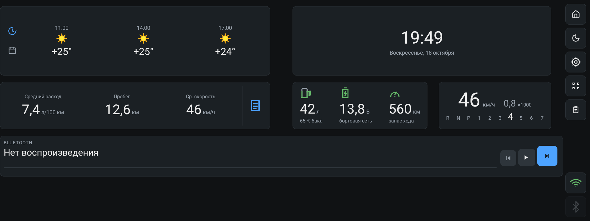
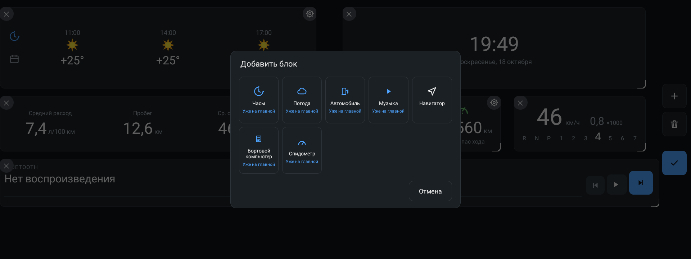
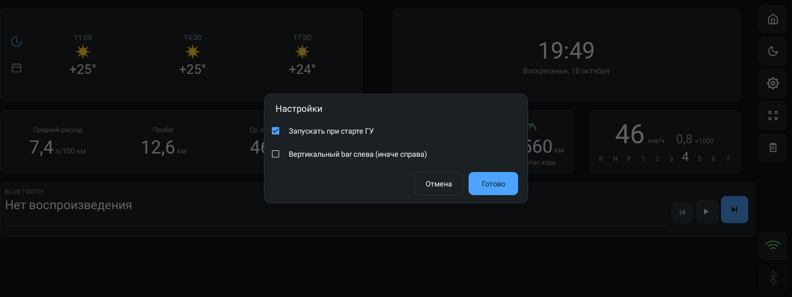
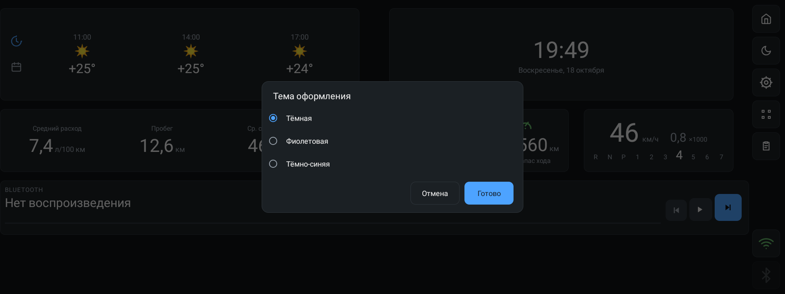
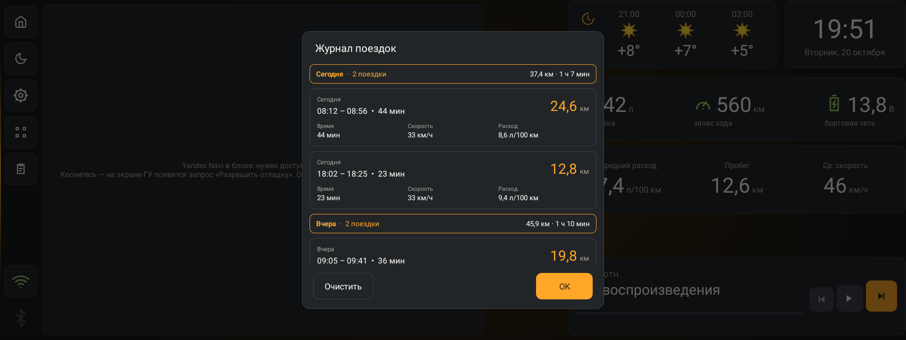
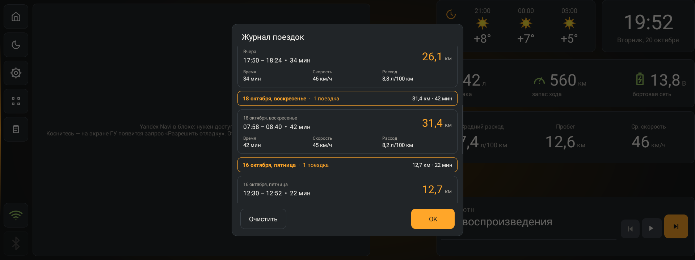
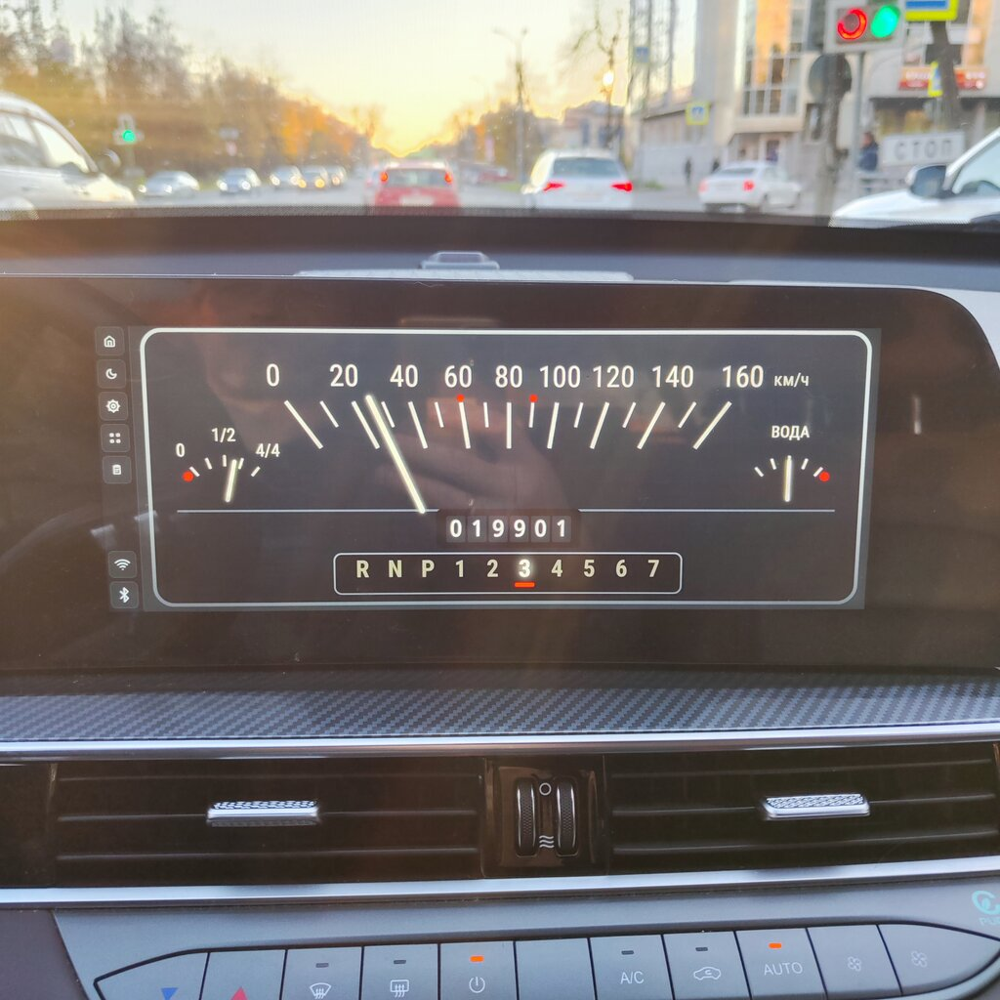
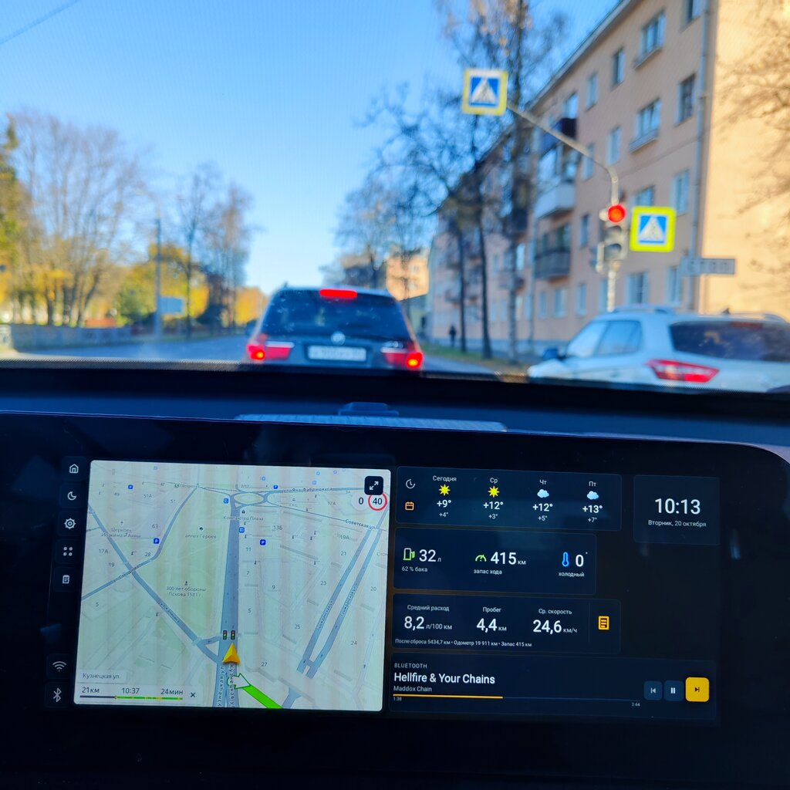

# Tenet t7 dash

Дашборд-лаунчер для головного устройства автомобиля (Android-мультимедиа).
Рисует домашний экран из настраиваемых «плиток»: часы, погода, состояние
автомобиля, музыка, навигатор и другое. Написан под штатное ГУ на
Android 9 (API 28), устанавливается сайдлоадом (вне Google Play).

> ## ⚠️ Проект полностью создан искусственным интеллектом
> Весь код этого репозитория сгенерирован ИИ. Автор **не несёт никакой
> ответственности** за работу, возможные сбои, повреждение данных, системы
> автомобиля или иные последствия использования. Применяйте на свой страх и
> риск, только на своём устройстве и с полным пониманием действий.

## Скриншоты

Главный экран:



| Добавление блока | Настройки | Тема оформления |
| --- | --- | --- |
|  |  |  |

Журнал поездок (открывается тапом по «Бортовому компьютеру»): группировка по
дням с итогами, дата с днём недели:

| Журнал поездок | Страница дальше — по датам |
| --- | --- |
|  |  |

Ретро-спидометр на экране ГУ и дашборд с навигатором в машине:

| Ретро-спидометр | Дашборд с навигатором |
| --- | --- |
|  |  |

## Возможности

- Сетка виджетов 100×70 клеток: перетаскивание, изменение размера, добавление и
  удаление прямо на главном экране (режим редактирования).
- Три темы оформления: тёмная, фиолетовая, тёмно-синяя.
- Вертикальная панель быстрых кнопок (домой, ночь, тема, редактирование,
  журнал, Wi-Fi, Bluetooth), с настройкой стороны — слева или справа.
- Автозапуск при старте ГУ: прошивка режет `BOOT_COMPLETED`, поэтому дашборд
  поднимают привязкой системных служб (слушатель уведомлений и службы
  специальных возможностей). Включается в настройках — приложение само
  выдаёт себе доступ к уведомлениям.
- Маршрут навигатора на дисплее приборки (см. «Интеграция с автомобилем»).
- Привязка к штатным данным: подписка на шину Desay SV, VHAL, приборную панель.

## Виджеты

| Виджет | Описание |
| --- | --- |
| Часы + погода | Часы с текущей погодой. |
| Погода | Прогноз (число дней и часов настраивается), °C/°F. |
| Автомобиль | Топливо, АКБ, запас хода, селектор, наружная температура. |
| Спидометр | Скорость, обороты, селектор передач; живые данные (~10 кадров/с из потока PPS приборки). Два вида: ретро-приборка со стрелками топлива/ОЖ, одометром и градусами у «ВОДА» (честные °C из a0ff/VHAL, иначе оценка по стрелке) и цифровой. |
| Бортовой компьютер | Средний расход, пробег, средняя скорость за поездку; тап открывает журнал поездок по дням. Журнал хранится ограниченный срок (в настройках приложения: неделя по умолчанию, 2 недели, месяц или всегда) — записи старше срока удаляются. |
| Музыка | Bluetooth AVRCP и плееры, транспортные кнопки. |
| Навигатор | Навигатор (например, Яндекс Навигатор) в окне размером с блок под дашбордом. |
| Wi-Fi | Статус подключения ГУ (SSID, IP, уровень сигнала) и вкл/выкл; тап — диалог: сохранённые и видимые сети, добавление сети по SSID/паролю, «забыть». |
| OBD (ELM) | Показания с Bluetooth-сканера ELM327: ОЖ, бортсеть, обороты, нагрузка, температура впускного воздуха, дроссель, топливные балансировки (B1), давление впускного коллектора, уровень топлива. Набор показателей выбирается в настройках плитки (multi-choice), отображаются только отмеченные. Тап — панель Bluetooth-диагностики: скан, спаривание, выбор адаптера, тест подключения, журнал статуса. |

Часы, погода, автомобиль, спидометр, бортовой компьютер, музыка, навигатор
входят в утверждённый набор сборки `prod` (релизы на GitHub). Wi-Fi и
экспериментальные/диагностические виджеты сборки `dev` (климат, OBD/ELM —
показатели с ELM327 с настраиваемым набором и диагностика Bluetooth
адаптера; «Обучение кнопкам» — обучение действиям автомобиля по шине Desay SV:
стёкла, замки, люки, зеркала; тестовые) — в релиз они не входят.

## Сборка

Требуется **JDK 21** (toolchain настроен автоматически через foojay) и Android
SDK. Ключ OpenWeatherMap (необязательно) кладётся в `local.properties` как
`openweathermap.key=...` (см. `local.properties.example`) — в репозитории он не
хранится.

```bash
./gradlew :app:assembleDevDebug     # все виджеты, отладочная
./gradlew :app:assembleProdDebug    # продовый набор, отладочная
./gradlew :app:assembleProdRelease  # продовый набор, подписанный релиз
```

Артефакты (имя APK: `tenet_t7_dash-<flavor>-<buildType>.apk`):

- `app/build/outputs/apk/dev/debug/tenet_t7_dash-dev-debug.apk`
- `app/build/outputs/apk/prod/debug/tenet_t7_dash-prod-debug.apk`
- `app/build/outputs/apk/prod/release/tenet_t7_dash-prod-release.apk`

Релиз подписывается стандартным debug-ключом (`keystore/debug.keystore`), чтобы
APK обновлялся поверх ранее установленной сборки без удаления. Это осознанное
решение: приложение сайдлоадное, магазины не используются.

Релизы собирает и GitHub Actions (`.github/workflows/prod-release.yml`): тег
`v*` запускает юнит-тесты, `assembleProdRelease` и публикует GitHub Release
с APK. Подпись — тем же debug-ключом, поэтому CI- и локальные сборки
взаимозаменяемы.

### Варианты поставки

- **dev** — все виджеты (разработка и отладка).
- **prod** — утверждённый набор повседневных виджетов.

## Установка

```bash
adb install -r app/build/outputs/apk/prod/release/tenet_t7_dash-prod-release.apk
adb shell am start -n com.dash.headunit/.MainActivity
```

## Интеграция с автомобилем

- **Шина Desay SV** — чтение топлива, бортового компьютера и т.п. через
  binder-сервис устройства; в dev-сборке есть «Обучение кнопкам»: поиск и
  воспроизведение команд (стёкла, замки, люки, зеркала) — запись только по
  явному подтверждению и на стоящей машине.
- **VHAL** — свойства AOSP и вендорские через `CarPropertyManager`.
- **Приборная панель** — снимки и записи для диагностики. Поток PPS
  используется как живой источник скорости/оборотов для спидометра.
- **Маршрут навигатора на приборке** — настройка «Маршрут навигатора
  на приборке» рисует ведение (стрелка манёвра, расстояние, улица, время
  прибытия, знак ограничения speed-limit, камеры) в оверлее на дисплее
  приборки (1920×720, ширина картинки настраивается), приборка при этом
  переключается в режим «навигация» штатным широковещанием Desay. Данные
  ведения берутся из уведомления Яндекс Навигатора и из окна навигатора
  (служба специальных возможностей, только чтение). Нужные права (оверлей,
  служба спец. возможностей, слушатель уведомлений) приложение выдаёт себе
  само через встроенный adb-канал. Для проверки с ПК есть exported-приёмник
  `com.dash.headunit.NAVI_CLUSTER` (право DUMP):
  `adb shell am broadcast -a com.dash.headunit.NAVI_CLUSTER --es cmd dump`.
- **Навигатор** — запускается под полупрозрачным дашбордом, его стек окон
  ужимается до блока (`am stack resize`) через ADB-канал к самому устройству
  (нужен сетевой adb: `adb tcpip 5555`; при первом подключении ГУ спросит
  «Разрешить отладку»). На эмуляторе вместо этого: `adb reverse tcp:5555 tcp:5555`
  (после каждого перезапуска эмулятора). «Пинок» навигатора выполняется после
  того, как его окно реально отрисовано.
- **Wi-Fi** — приложение само управляет Wi-Fi (вкл/выкл, подключение,
  добавление/забытие сетей), т.к. системные настройки ГУ обрезаны.

## Структура

```
app/src/main/java/com/dash/headunit/
├─ dashboard/     сетка, типы виджетов, доступность, хранение раскладки
├─ widgets/       реализации виджетов (View)
├─ car/           источники данных автомобиля (Desay, VHAL, приборка)
├─ navi/          подложка и запуск навигатора
│  └─ cluster/    маршрут навигатора на дисплее приборки
├─ wifi/          состояние и управление Wi-Fi
├─ elm/           работа с OBD/ELM327
├─ music/         слушатель медиа (и уведомлений навигатора для приборки)
├─ ui/, theme/    диалоги и оформление
└─ diag/          приёмники диагностических снимков и проверок с ПК
```

## Отказ от ответственности

Проект распространяется «как есть», без каких-либо гарантий. Создан ИИ,
используется исключительно на собственное усмотрение и риск.
