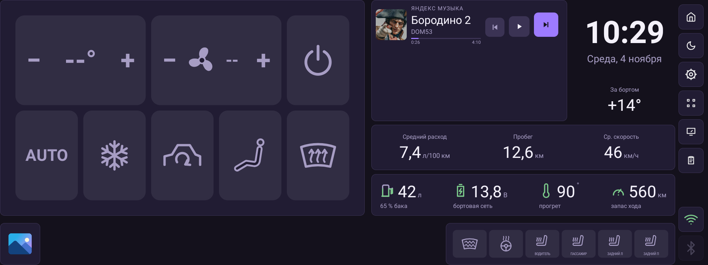
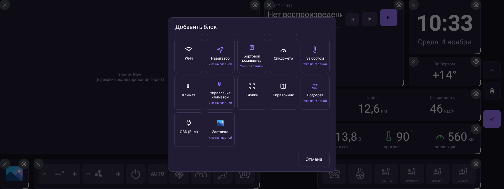
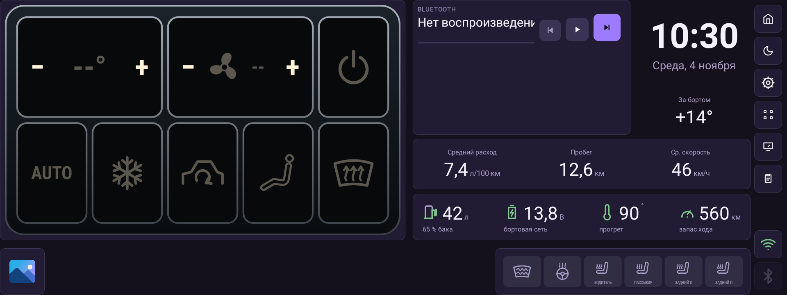

# Виджет «Управление климатом»

Плитка с кнопками климата: температура водителя и пассажира, вентилятор,
питание, AUTO, A/C, рециркуляция, режим обдува, обдув лобового и подогревы.
Тап по кнопке сразу отправляет команду в шину и показывает новое состояние,
не дожидаясь подтверждения.

## Чем отличается от других климатических виджетов

| Виджет | Что делает |
| --- | --- |
| «Климат» | Только показывает состояние климата текстом или иконками. |
| «Управление климатом» | Кнопки: пишут команды в шину и показывают состояние. Состав и порядок кнопок настраиваются. |
| «Подогрев» | Тот же вид кнопок, но фиксированный набор: обогрев лобового и четыре сиденья. Внешний вид настраивается в самой плитке (вид «Ретро»). |

## Как добавить

1. Войти в режим редактирования (кнопка с сеткой на боковой панели).
2. Нажать «+ Добавить блок».
3. Выбрать «Управление климатом». Плитка появится на сетке.

Плитку можно растягивать и сжимать за правый нижний угол: кнопки
перестраиваются под размер блока.

## Кнопки

| Кнопка | Вид | Действие | По умолчанию |
| --- | --- | --- | --- |
| Температура водителя | Широкая, «− значение +» | Уставка водителя, шаг ±1 °C | Да |
| Вентилятор | Широкая, «− скорость +» | Скорость 1–7 | Да |
| Температура пассажира | Широкая, «− значение +» | Уставка пассажира, шаг ±1 °C | Да |
| Вкл/выкл климата | Обычная | Включить/выключить климат | Да |
| AUTO | Обычная | Автоматический режим | Да |
| A/C | Обычная | Компрессор кондиционера | Да |
| Рециркуляция | Обычная | Забор воздуха из салона | Да |
| Режим обдува | Обычная | Перебор режимов: лицо → ноги → лицо+ноги → ноги+стекло | Да |
| Обдув лобового (MAX) | Обычная | Максимальный обдув лобового стекла | Да |
| SYNC | Обычная | Синхронизация зон водителя и пассажира | Нет |
| Обогрев лобового | Обычная | Обогрев лобового стекла | Нет |
| Подогрев сиденья водителя | Обычная, с подписью | Уровни 1 → 2 → 3 → выкл | Нет |
| Подогрев сиденья пассажира | Обычная, с подписью | Уровни 1 → 2 → 3 → выкл | Нет |
| Подогрев заднего левого сиденья | Обычная, с подписью | Уровни 1 → 2 → 3 → выкл | Нет |
| Подогрев заднего правого сиденья | Обычная, с подписью | Уровни 1 → 2 → 3 → выкл | Нет |

Широкие кнопки делятся на зоны: левая — «−», правая — «+», середина только
показывает значение. У остальных кнопок тап переключает состояние, а у
сидений — перебирает уровни. «Уже включённые» кнопки подсвечиваются: в
классической теме — цветом темы (обогревы — жёлтым), в ретро — «лампами».

## Настройки

- **Кнопки** — список всех доступных кнопок. Переключатель показывает или
  прячет кнопку на плитке, стрелки ↑/↓ меняют порядок. Список прокручивается.
- **Тема** — «Классическая» (цвета дашборда) или «Ретро» (чёрные таблички в
  металлической рамке с подсветкой, как у ретро-приборов).
- **Фон** — общий фон плитки: «Как в теме», «Градиентный» или «Прозрачный».

Изменения применяются по «Готово»; «Отмена» их отбрасывает.

## Тема «Ретро»

В ретро-теме каждая кнопка — отдельная чёрная табличка с металлической
рамкой, а состояние показывают «лампы»: белые и зелёные — значения и обычные
режимы, синяя — A/C, янтарные — обогревы. Символы и подписи сидений остаются
читаемыми на тёмном фоне.

## Раскладка

Виджет подстраивается под блок: алгоритм делит кнопки на 1–4 ряда так, чтобы
кнопка была как можно крупнее. Широкая кнопка занимает две «единицы», обычная
— одну.

- В длинной полосе (например, 47×11 клеток) все кнопки выстраиваются в один
  ряд.
- В высоком блоке кнопки раскладываются в несколько рядов и становятся
  крупнее — удобнее попадать пальцем в машине.
- Если кнопок слишком много и они становятся мелкими — уберите лишние в
  настройках или увеличьте блок.

## Данные и ограничения

- Значения читаются из штатной шины Desay SV и VHAL. Если данных нет,
  температура и скорость вентилятора показываются как `--`, а кнопки — как
  выключенные.
- Нажатие показывает новое значение сразу (оптимистично), затем виджет
  сверяется с шиной. Для сидений это окно больше, потому что их состояние
  читается с задержкой.
- Пока шина не отдала текущую температуру, кнопки «−» и «+» уставки
  игнорируются — виджет не знает, от какого значения считать.
- Команды пишутся в `CarInfoService` штатной шины. На эмуляторе или на ГУ без
  этой шины кнопки нажимаются, но фактического управления не будет.
- Виджет не заменяет штатную панель климата: он управляет теми же функциями,
  которые доступны шине. Если функция не поддерживается комплектацией,
  команда может быть проигнорирована.
- Задние сиденья и часть обогревов зависят от комплектации; их кодировки в
  шине могут отличаться.

## Для разработчиков

- `app/src/main/java/com/dash/headunit/widgets/ClimateControlView.kt` — вид,
  раскладка, тапы и оптимистичное состояние.
- `app/src/main/java/com/dash/headunit/car/ClimateControl.kt` — команды и
  варианты кодирования для шины Desay.
- `app/src/main/java/com/dash/headunit/car/ClimateHub.kt` — чтение состояния
  климата и опрос шины.
- `RetroClimateIcons` — символы и «лампы» для классической и ретро-тем.
- Настройки хранятся в `WidgetSettingsStore` как опции `theme`, `items` и
  `order` (с префиксом id плитки). `items` — видимые кнопки, `order` — полный
  порядок.

См. также [README](../README.md) и [CHANGELOG](../CHANGELOG.md).
