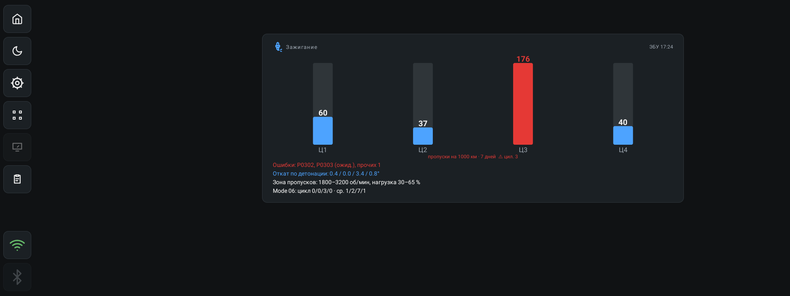
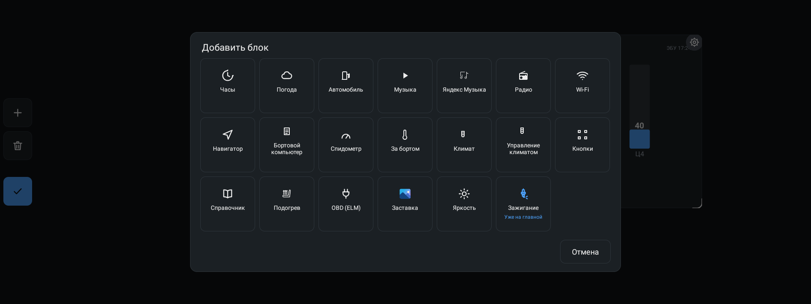
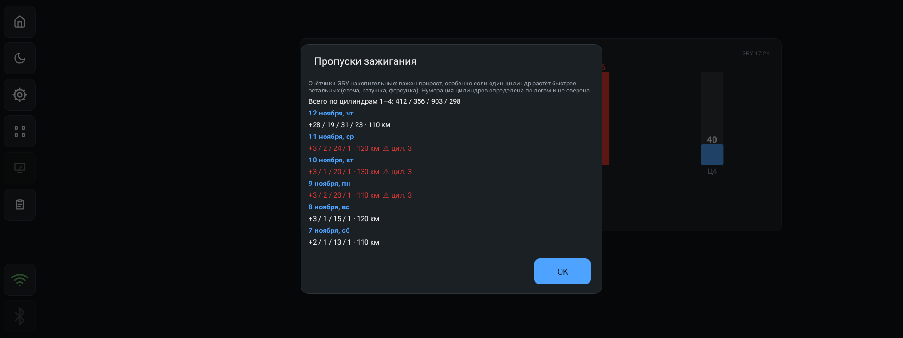
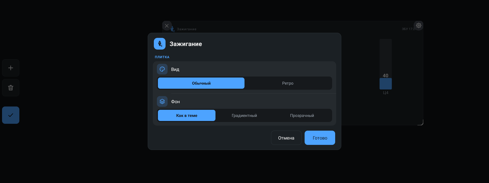
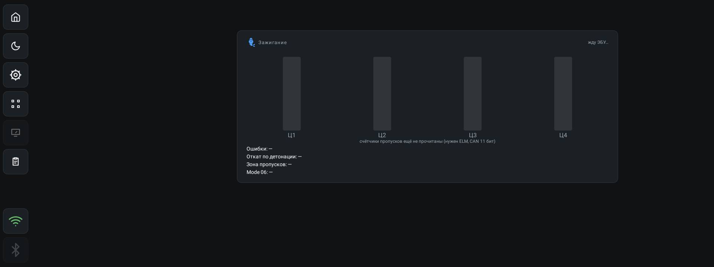

# Виджет «Зажигание»

> **Виджет в разработке.** Он добавлен в текущей сборке (раздел Unreleased в
> CHANGELOG) и на машине пока не проверен: цифры считываются по логам, часть
> масштабов не сверена с приборкой. Пользоваться осторожно — как источник
> истины для ремонта зажигания он пока не годится.

Пропуски зажигания по цилиндрам: четыре столбика, прирост на 1000 км за
неделю, перекос между цилиндрами, ошибки P030x, откат угла по детонации,
зона пропусков и монитор Mode 06. Данные — по Bluetooth-адаптеру ELM327,
из блока управления двигателем.

## Что делает

- Показывает прирост счётчиков пропусков по цилиндрам 1–4 — не сами
  накопительные счётчики, а их рост: именно рост говорит о неисправности.
- Ищет цилиндр, который растёт заметно быстрее остальных, и подсвечивает
  его красным — это признак свечи, катушки или форсунки.
- Показывает ошибки пропусков P0300–P0304 (сохранённые и ожидающие), откат
  угла по детонации по цилиндрам, зону пропусков (обороты и нагрузка) и
  стандартный монитор пропусков Mode 06, если ЭБУ его поддерживает.
- Ведёт журнал снимков счётчиков с пробегом — по нему и считается прирост.
- По тапу открывает историю прироста по дням.

## Что нужно

- **Адаптер ELM327 по Bluetooth** (SPP) — выбирается в виджете «OBD (ELM)».
- **CAN 11 бит** — 500 или 250 кбит. Только на нём известен физический адрес
  ЭБУ двигателя (7E0), и только на нём счётчики пропусков читаются. Если шина
  оказалась другой, счётчики не придут и виджет напишет «нужен ELM, CAN 11
  бит».
- **Включённое зажигание** — иначе ЭБУ молчит.
- Профиль машины: счётчики пропусков — это заводские DID Chery Tiggo 7
  (22018A, 220181–220183), на других машинах их может не быть. В профиле
  «Cherry Tiggo 7» они описаны отдельной группой «misfire».

Журнал и прирост считаются при любом профиле — важно только, чтобы ЭБУ
отвечал.

## Как добавить

1. Войти в режим редактирования (кнопка с сеткой на боковой панели).
2. Нажать «+ Добавить блок».
3. Выбрать «Зажигание». Плитка появится на сетке.

Плитка рассчитана на широкий блок (по умолчанию 56×40 клеток): четыре
столбика и четыре строки под ними. Её можно растягивать и сжимать за правый
нижний угол.

## Что показывает виджет

| Строка | Что это |
| --- | --- |
| Иконка и «Зажигание» | Заголовок |
| Статус справа | «ЭБУ 17:24» — свежие данные; «нет связи с 17:24» — данные протухли; «жду ЭБУ…» — ответа пока нет; «адаптер ELM не выбран» — адаптер не выбран в виджете «OBD (ELM)» |
| Столбики Ц1–Ц4 | Прирост пропусков по цилиндрам; число над столбиком, цилиндр под ним |
| Подпись столбиков | По чему посчитан прирост и, если есть, «⚠ цил. N» — перекос |
| Ошибки | P0300–P0304 (ожидающие помечены «ожид.»), остальные — «прочих N» |
| Откат по детонации | Откат угла зажигания по цилиндрам, ° |
| Зона пропусков | Обороты и нагрузка, где пропуски бывают |
| Mode 06 | Стандартный монитор пропусков: «цикл … · ср. …» по цилиндрам 1–4 |

Цвет подсказывает, где проблема: красным — ошибки пропусков и цилиндр с
перекосом, цветом темы — прочие ошибки и откат от 3°, зелёным — что ошибок
нет.

## По чему считается прирост

Счётчики ЭБУ накопительные, поэтому важна разница. Виджет выбирает первую
подходящую величину:

| Подпись | Когда показывается |
| --- | --- |
| «пропуски на 1000 км · 7 дней» | Есть прирост и пробег за неделю от 50 км |
| «пропуски на 1000 км · 30 дней» | То же, но за месяц |
| «пропуски в час работы · 7 дней» | Пробега мало (меньше 50 км), но есть время работы ЭБУ от часа |
| «пропуски в час работы · 30 дней» | То же за месяц |
| «пропуски за поездку» | Журнала ещё нет — прирост с начала текущей поездки |
| «счётчики всего — прирост появится после поездок» | Счётчики есть, а прирост посчитать пока не из чего |

Пробег берётся с автомобиля (шина ГУ), время работы ЭБУ считается по
паузам между его ответами. Поэтому «на 1000 км» требует работающего
одометра, а «в час» — накопленного времени.

**Перекос** — цилиндр, который растёт хотя бы в два раза быстрее среднего
по остальным и набрал от 20 пропусков. Он подсвечивается красным, а в
подписи появляется «⚠ цил. N».

## История

Тап по виджету открывает окно с приростом по дням, свежие сверху: дата,
прирост по цилиндрам и пройденный за день пробег. Цифры с пометкой «⚠ цил.
N» — дни, когда перекос был заметен.

Счётчики ЭБУ накопительные: важен прирост, особенно если один цилиндр
растёт быстрее остальных. Нумерация цилиндров определена по логам и с
приборкой не сверена.

## Настройки

| Параметр | Значения | По умолчанию |
| --- | --- | --- |
| Вид | «Обычный», «Ретро» | «Обычный» |
| Фон | «Как в теме», «Градиентный», «Прозрачный» | «Как в теме» |

Своих настроек у виджета нет: что показывать, решает ЭБУ.

## Без ЭБУ

Без адаптера или без ответа ЭБУ столбики пустые, а подпись говорит, что
счётчики ещё не прочитаны. Строки ошибок, отката, зоны пропусков и Mode 06
в этом случае — прочерки.

## Поведение и ограничения

- Опрос идёт в фоне даже без открытого виджета — журнал копится, пока
  приложение живо. Счётчики и зона пропусков читаются раз в 30 секунд,
  ошибки и Mode 06 — раз в минуту. Откат по детонации спрашивается каждый
  круг, но только пока виджет на экране.
- Журнал пишется в `files/ignition/misfire.csv` — по строке на снимок:
  время, пробег, время работы ЭБУ и четыре счётчика. Строка добавляется,
  если счётчики изменились (не чаще раза в 10 минут) или началась новая
  поездка; новая поездка считается после перерыва в чтениях дольше 10 минут.
  Журнал хранится год, файл при этом ужимается до 512 КБ.
- Если ЭБУ стёр счётчики после очистки ошибок, прирост считается от нового
  значения — старые шаги в расчёт не идут.
- Зона пропусков — это окно, в котором пропуски бывали в последний раз;
  «не было» означает, что ЭБУ отдаёт пустые значения.
- Поддержка Mode 06 проверяется один раз за сессию связи с ЭБУ: если ЭБУ не
  отвечает на `06A0`, виджет пишет «ЭБУ не поддерживает».
- Откат угла по детонации читается в градусах с масштабом 0,375° на бит —
  масштаб не сверен с приборкой, на холостых всегда 0.
- Виджет ничего не сбрасывает и не чинит: ни ошибок, ни счётчиков. Очистка
  ошибок — только штатным сканером.
- На машине виджет не проверен.

## Для разработчиков

- `app/src/main/java/com/dash/headunit/widgets/IgnitionWidgetView.kt` — вид:
  столбики, подписи, строки ошибок, окно истории.
- `app/src/main/java/com/dash/headunit/elm/IgnitionMonitor.kt` — разбор ответов
  ЭБУ, журнал снимков и расчёты (прирост, перекос, по дням).
- `app/src/main/java/com/dash/headunit/elm/ElmHub.kt` — опрос: команды
  зажигания добавлены к кругу как `can11Only` (только CAN 11 бит), ключи в
  `readings` — `ign:команда`.
- Команды ЭБУ: счётчики `22018A`, `220181`–`220183`; откат `220170`–`220173`;
  зона пропусков `220184`–`220187`; ошибки `03` и `07`; Mode 06 `06A0`,
  `06A1`–`06A5`.
- Профиль «Cherry Tiggo 7» (`app/src/main/assets/profiles/`) — группа
  «misfire» с теми же счётчиками и зоной.
- Настройки виджета — общие для всех плиток: `opt_look` и `opt_bg` в
  `WidgetSettingsStore`.

См. также [README](../README.md) и [CHANGELOG](../CHANGELOG.md).
