# Виджет «Радио»

Штатный FM/AM-тюнер головного устройства: диапазон, частота, имя станции,
поиск станций, пауза, своё название и избранное. Три вида: «Современный»
(по умолчанию), «Обычный» и «Ретро» — советская автомагнитола со шкалой
и стрелкой.

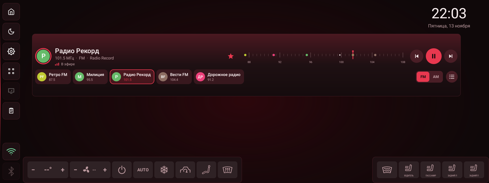

## Что делает

- Показывает диапазон (FM или AM), частоту и имя станции (RDS — только у FM).
- Ищет станцию вперёд и назад, ставит на паузу, переключает диапазон.
- Ведёт свой список станций: штатное радио наружу его не отдаёт, поэтому
  список собирается перебором диапазона.
- Держит своё название станции, цвет её значка и избранное — до 12 штук.
- Показывает карточку «О станции»: когда и сколько её слушали.
- Тап по частоте (в современном виде — долгое нажатие на название) делает
  радио источником звука и открывает штатный экран.

## Как добавить

1. Войти в режим редактирования (кнопка с сеткой на боковой панели).
2. Нажать «+ Добавить блок».
3. Выбрать «Радио». Плитка появится на сетке.

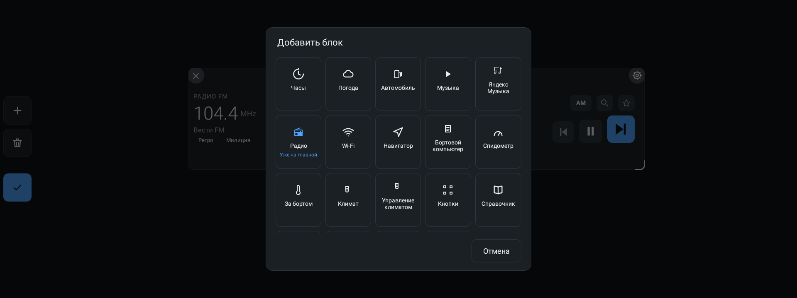

Плитку можно растягивать и сжимать за правый нижний угол. Виджет рассчитан
на широкий блок: слева частота, справа кнопки.

## Современный вид

Слева значок станции (цветной круг с буквами названия), крупно название,
под ним частота, диапазон и RDS-имя (если своё название его заслоняет),
ниже — «В эфире» с прыгающими полосками или «Пауза». Кольцо вокруг значка —
радио играет. Дальше звезда, мини-шкала диапазона и транспорт. Внизу — ряд
избранного, переключатель FM | AM и кнопка списка станций.

| Элемент | Действие |
| --- | --- |
| Значок или название | Карточка «О станции». Во время переключения — отменить его |
| Значок или название, долгое нажатие | Сделать радио источником и открыть штатный экран |
| Звезда | Добавить текущую станцию в избранное (спросит своё название) или убрать |
| Точка на шкале | Настроиться на эту станцию |
| Свайп по шкале | Влево — поиск станции вперёд, вправо — назад |
| Тап по шкале во время переключения | Отменить переключение |
| ⏮ / ⏯ / ⏭ | Поиск назад, пауза и пуск, поиск вперёд |
| Карточка избранного | Настроиться; у играющей — карточка «О станции» |
| Карточка избранного, долгое нажатие | Меню: о станции, переименовать, цвет значка, сдвинуть влево/вправо, убрать из избранного |
| «+ В избранное» | Добавить играющую станцию в ряд (есть, если её там ещё нет) |
| FM / AM | Переключить диапазон |
| Кнопка списка | Диалог «Радиостанции» |

На шкале точки — станции своего списка в текущем диапазоне; избранные
крупнее и цветом своего значка. Красная стрелка — текущая частота.

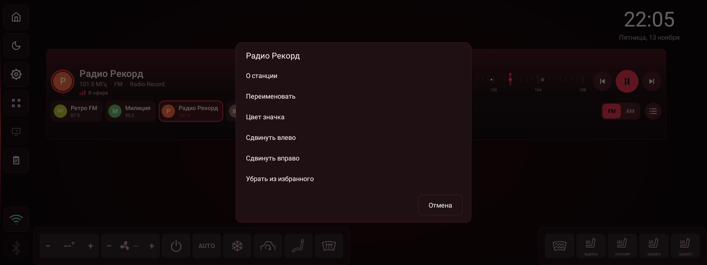

### Переключение на станцию

Настроиться на частоту напрямую служба радио не умеет, поэтому виджет
перебирает станции тюнера, пока не попадёт на нужную. Это занимает
несколько секунд. Пока идёт перебор, строка состояния пишет «Переключаю
на …», карточка цели обведена пунктиром, на шкале пульсирует кольцо цели.
Тап по названию или шкале отменяет переключение.

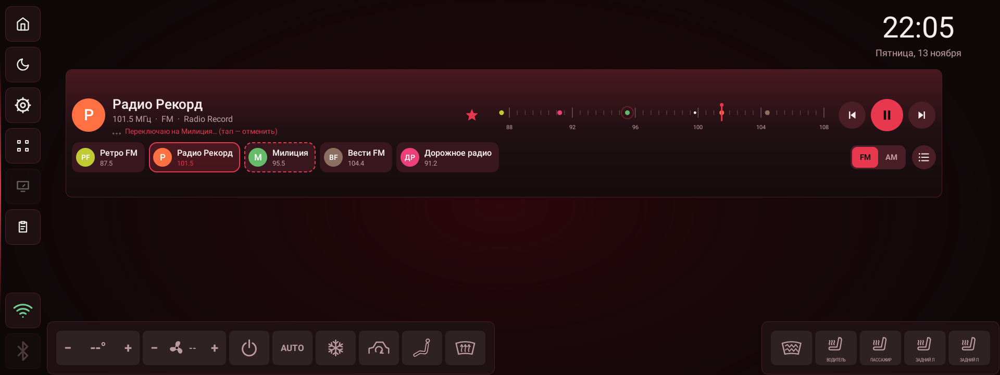

### Под размер блока

- Высота меньше 140 dp — без ряда избранного; FM | AM и кнопка списка
  переезжают в верхний ряд.
- Высота от 270 dp — избранное в два ряда.
- Ширина меньше 720 dp — без шкалы; меньше 500 dp — без звезды; меньше
  430 dp — без ⏮ и со значком поменьше; меньше 380 dp — без FM | AM.

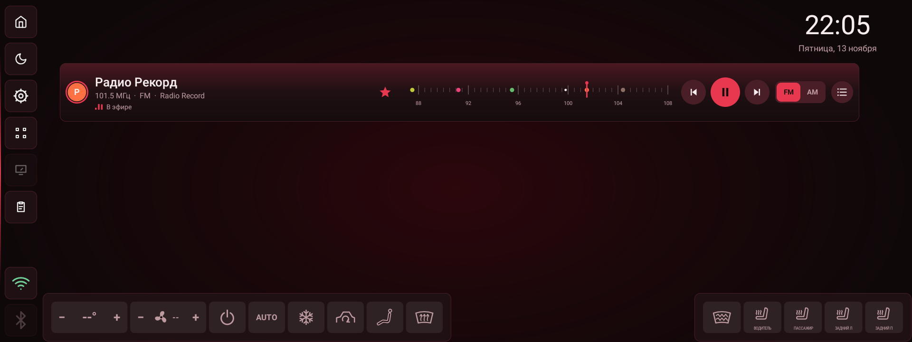

## Карточка «О станции»

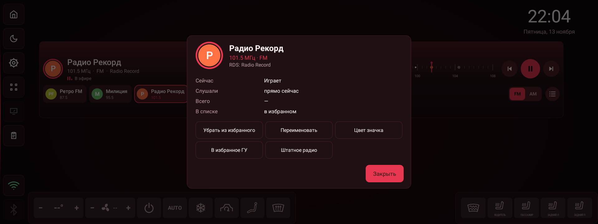

Открывается тапом по названию, по карточке играющей станции в ряду
избранного или пунктом «О станции» в меню избранного.

- Значок, название, частота и диапазон, RDS-имя (если отличается).
- «Сейчас» — играет, пауза, идёт переключение или не играет.
- «Слушали» — «прямо сейчас», «сегодня в 14:05», «вчера в …», дата.
- «Всего» — сколько станцию слушали за всё время.
- «В списке» — в избранном, в списке станций или нет в списке.
- «Избранное ГУ» — только у играющей станции: служба сообщает его лишь для
  текущей.

Кнопки: «Включить» (у неиграющей), «В избранное» / «Убрать из избранного»,
«Переименовать», «Цвет значка» (12 цветов или «Авто» — цвет по частоте),
«В избранное ГУ» (у играющей), «Штатное радио».

Время прослушивания виджет считает сам: отрезок — пока радио играет одну
частоту без перебора. Отрезки короче 10 секунд (пролистывание станций) не
считаются. На флеш пишется только в конце отрезка (смена станции, пауза,
перебор).

## Обычный вид

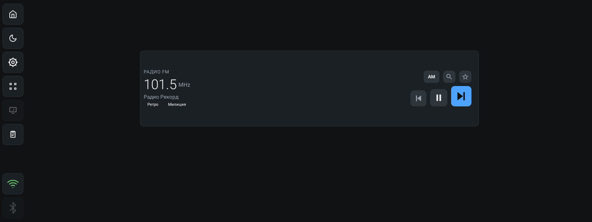

Слева — подпись диапазона («РАДИО FM»), крупная частота с единицей, имя
станции и ряд кнопок избранного. Справа — кнопки: переключатель диапазона,
лупа, звезда, а под ними транспорт.

| Элемент | Действие |
| --- | --- |
| Частота или имя станции | Сделать радио источником звука и открыть штатный экран |
| Кнопка FM/AM | Переключить диапазон. На кнопке написано, куда переключит |
| Лупа | Открыть список станций |
| Звезда | Добавить текущую станцию в избранное (сразу спросит своё название) или убрать из него |
| Звезда, долгое нажатие | Открыть список станций |
| Кнопки избранного под именем | Тап — настроиться на станцию, долгое нажатие — своё название |
| ◀◀ | Поиск станции назад |
| ⏯ | Пауза и пуск |
| ▶▶ | Поиск станции вперёд |

Когда радио играет, ⏯ показывает паузу, иначе — play. Звезда заливается
цветом темы, если станция в избранном.

Частота выводится как её отдаёт тюнер: у FM — в МГц (101.5 МГц), у AM — в
кГц. Под именем станции может стоять «Пауза».

## Диапазон AM

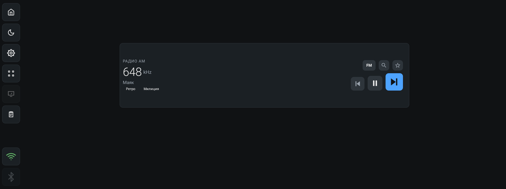

Переключение диапазона кнопкой FM/AM (в ретро-виде — клавишами справа от
шкалы) переводит тюнер на AM и обратно. Частота AM показывается в
килогерцах, шкала ретро-вида — в «×100 кГц», как на старых приёмниках.

## Список станций

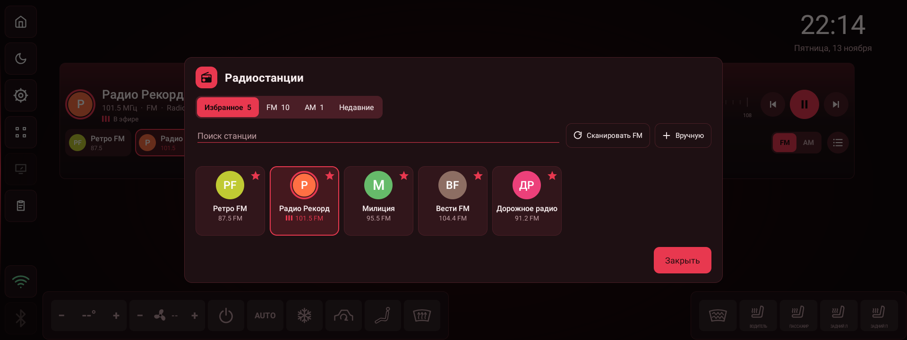

Открывается лупой в обычном виде (долгим нажатием на звезду — тоже).

- **Поиск станции** — по своему названию, по RDS и по частоте. «101,5»
  равно «101.5».
- **Искать в диапазоне** — перебор диапазона: радио переключается со
  станции на станцию, как стрелками в штатном радио, а найденное
  складывается в список. Кнопка превращается в «Остановить», рядом пишется
  «Найдено станций: N».
- **Добавить станцию** — вручную: частота (в МГц для FM, в кГц для AM) и
  название.
- **В избранное ГУ** — добавить или убрать текущую станцию из избранного
  *штатного* радио.

Список разделён на «Избранное» и «Найденные станции». В строке станции:
частота — настроиться на неё, название — задать своё, звезда — избранное.
Долгое нажатие на строку — убрать станцию из списка.

### Перебор диапазона

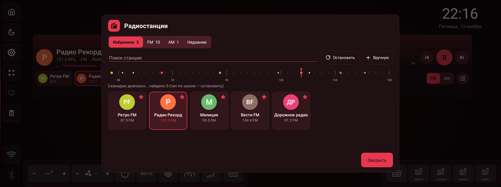

Пока идёт перебор, кнопка показывает «Остановить», а под ней — сколько
станций найдено. В конце — «Перебор закончен» или «Станций не найдено —
тюнер не отдал список».

## Вид «Ретро»

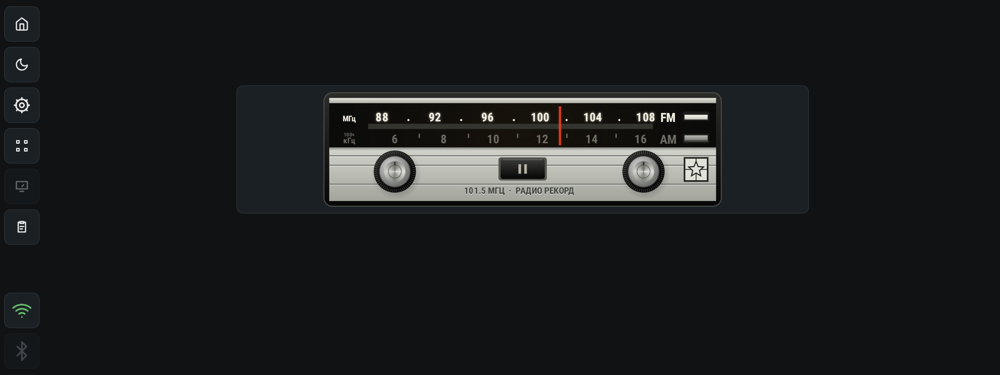

Советская автомагнитола: чёрный корпус, сверху стеклянное окно шкалы в две
строки (FM в МГц, AM в «×100 кГц») с красной визирной стрелкой и клавишами
диапазонов справа; ниже — серебристая панель, две хромированные ручки, чёрная
клавиша посередине и табличка со звездой. Под клавишей выгравирована
текущая частота и станция.

| Элемент | Действие |
| --- | --- |
| Левая ручка | Поиск станции назад (ручка проворачивается) |
| Правая ручка | Поиск станции вперёд |
| Чёрная клавиша посередине | Пауза и пуск |
| Клавиши FM и AM справа от шкалы | Переключить диапазон |
| Табличка со звездой | Избранное *штатного* радио ГУ |
| Тап по шкале | Открыть штатное радио |

Вид рисуется целиком на холсте и не зависит от темы дашборда.

Обратите внимание: звезда в обычном виде — это избранное самого виджета (до
6 станций, с подписями кнопками), а звезда в ретро-виде — избранное штатного
радио ГУ. Это разные списки.

## Настройки

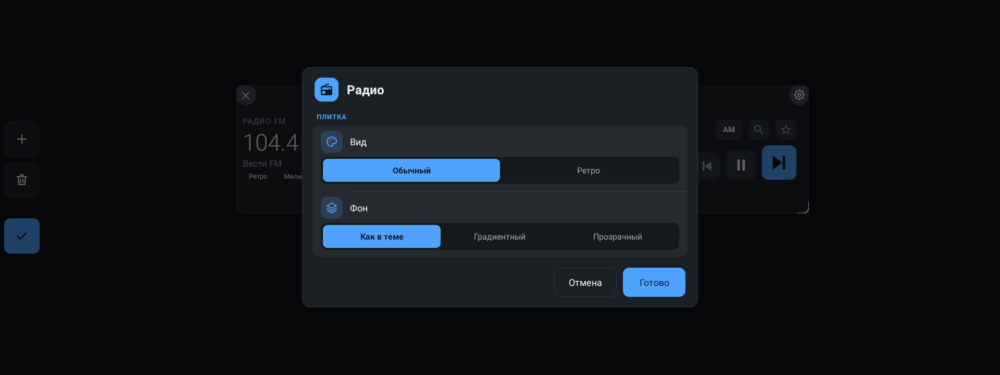

| Параметр | Значения | По умолчанию |
| --- | --- | --- |
| Вид | «Современный», «Обычный», «Ретро» | «Современный» |
| Фон | «Как в теме», «Градиентный», «Прозрачный» | «Как в теме» |

Своих настроек у виджета нет: частота, диапазон и станция — это состояние
тюнера, а не виджета.

## Поведение и ограничения

- Виджет работает только со штатным тюнером ГУ (служба SVMedia). На
  эмуляторе или на другой прошивке виджет пишет «Штатное радио недоступно»,
  а кнопки приглушаются. Пока служба не ответила — «Подключение к радио…».
- Списка станций штатное радио наружу не отдаёт, поэтому виджет собирает его
  перебором диапазона. В списке оказываются только те станции, которые
  тюнер знает сам.
- Настройка на сохранённую станцию идёт тем же перебором: если станции в
  списке тюнера больше нет, виджет пишет «Станции нет в списке тюнера».
- RDS есть только у FM; в AM имя станции не показывается.
- Интерфейс службы не отдаёт мощность сигнала, стерео и бегущую строку RDS —
  виджет их не показывает.
- Свой список станций и избранное хранятся на устройстве (prefs
  `radio_stations`), переживают перезапуск приложения. Время прослушивания —
  в prefs `radio_stats`.
- Если вид плитки уже сохраняли в настройках, остаётся сохранённый вид;
  «Современный» включается в настройках плитки.
- Избранное виджета (до 12 штук) и избранное штатного радио ГУ — разные
  списки: первое живёт в приложении, второе — в SVMedia.
- Радио и музыка делят источник звука ГУ. Поэтому виджет «Музыка» перед
  «Плей» переключает ГУ на Bluetooth-музыку, а радио ставит на паузу.
- Разрешений приложение для радио не просит: служба SVMedia экспортирована
  без `android:permission`.
- Лог обмена со службой — только в памяти (debug-экран) и в logcat, на
  флеш не пишется.
- На ГУ виджет пока не проверен.

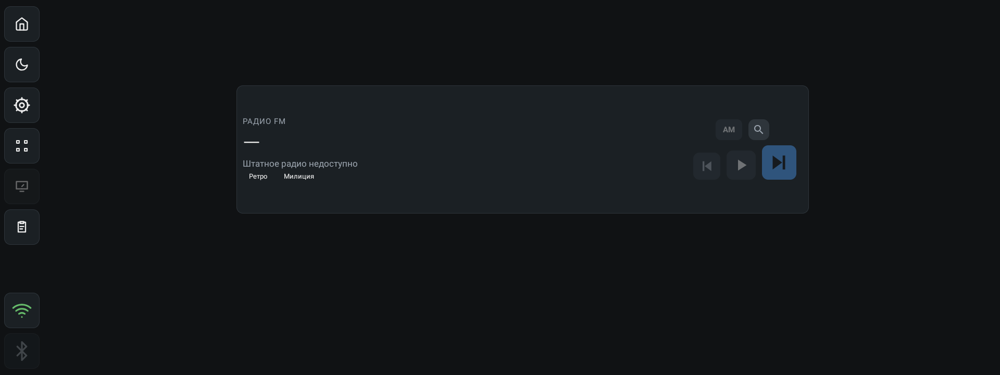

## Для разработчиков

- `app/src/main/java/com/dash/headunit/widgets/ModernRadioView.kt` —
  современный вид: раскладка под размер блока, ряд избранного, состояние
  переключения.
- `app/src/main/java/com/dash/headunit/widgets/RadioViews.kt` — значок
  станции (`StationAvatarView`), «в эфире» (`OnAirView`), мини-шкала
  (`BandScaleView`).
- `app/src/main/java/com/dash/headunit/widgets/RadioStationCard.kt` — карточка
  «О станции», выбор цвета, меню избранного, общие действия со станцией.
- `app/src/main/java/com/dash/headunit/radio/RadioStats.kt` — учёт
  прослушивания: JSON в prefs `radio_stats` (ключ — `RadioStations.keyOf`).
- `app/src/main/java/com/dash/headunit/widgets/RadioWidgetView.kt` — обычный
  вид: раскладка, кнопки, избранное под названием.
- `app/src/main/java/com/dash/headunit/widgets/RetroRadioView.kt` — ретро-вид:
  вся отрисовка на `Canvas`, шкала, стрелка, ручки, попадания по координатам.
- `app/src/main/java/com/dash/headunit/widgets/RadioStationsDialog.kt` — диалог
  «Радиостанции»: поиск, перебор, добавление, избранное.
- `app/src/main/java/com/dash/headunit/radio/RadioHub.kt` — клиент штатного
  тюнера: привязка к службе, команды (`next`, `pre`, `play_or_pause`,
  `change_collect`), состояние, перебор диапазона, лог.
- `app/src/main/java/com/dash/headunit/radio/RadioStations.kt` — свой список
  станций и избранное: JSON в prefs `radio_stations` (ключ `list`; поля
  `c` — свой цвет, `o` — место в ряду избранного), поиск, нормализация
  частоты, буквы и цвет значка.
- Настройки виджета — общие для всех плиток: `opt_look` (`modern`/`classic`/`retro`;
  без значения — `modern`)
  и `opt_bg` (`theme`/`gradient`/`transparent`) в `WidgetSettingsStore`.
- Тесты: `app/src/test/java/com/dash/headunit/radio/` — разбор ответов
  службы (`RadioHubJsonTest`), список станций (`RadioStationsTest`) и учёт
  прослушивания (`RadioStatsTest`).
- Разбор интерфейса SVMedia — в [research/radio-aidl.md](research/radio-aidl.md).

См. также [README](../README.md) и [CHANGELOG](../CHANGELOG.md).
