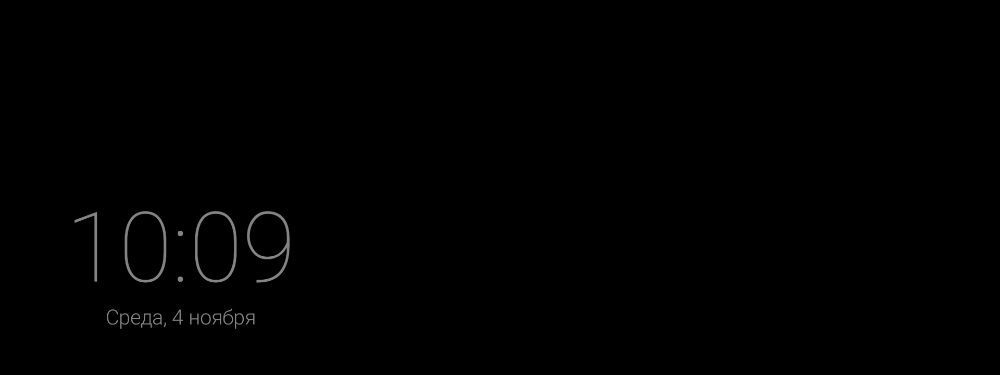
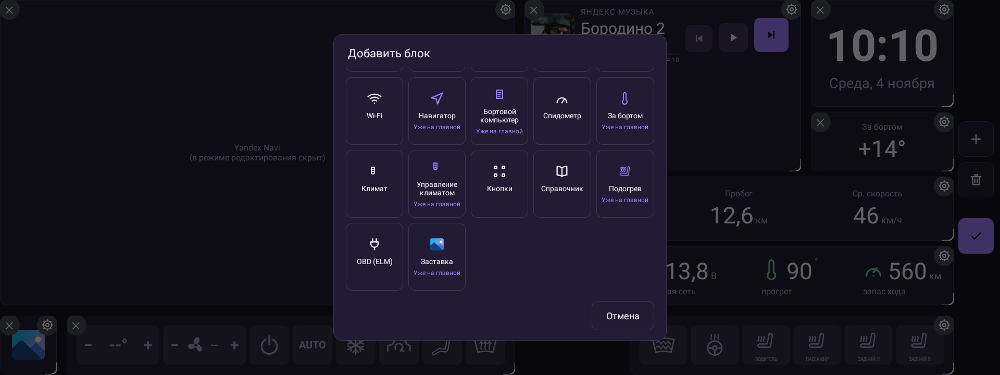
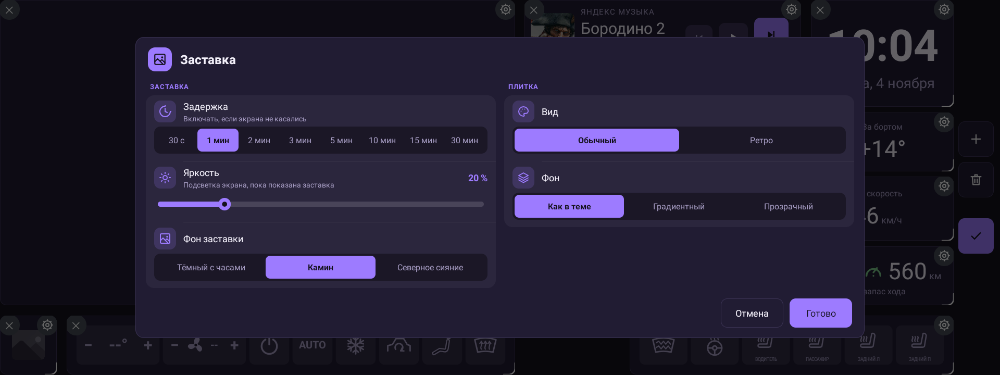
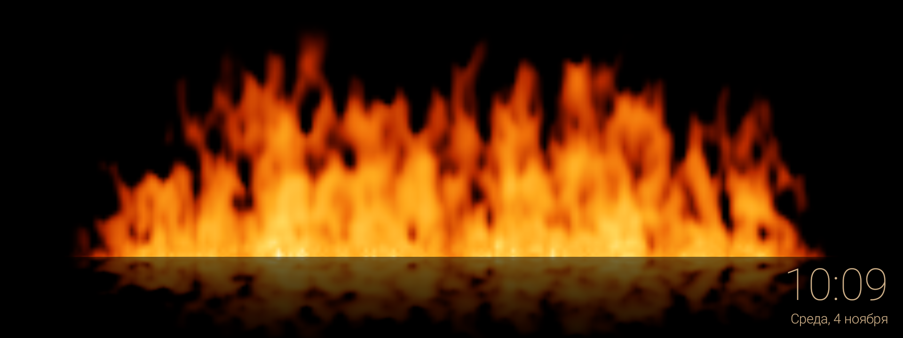
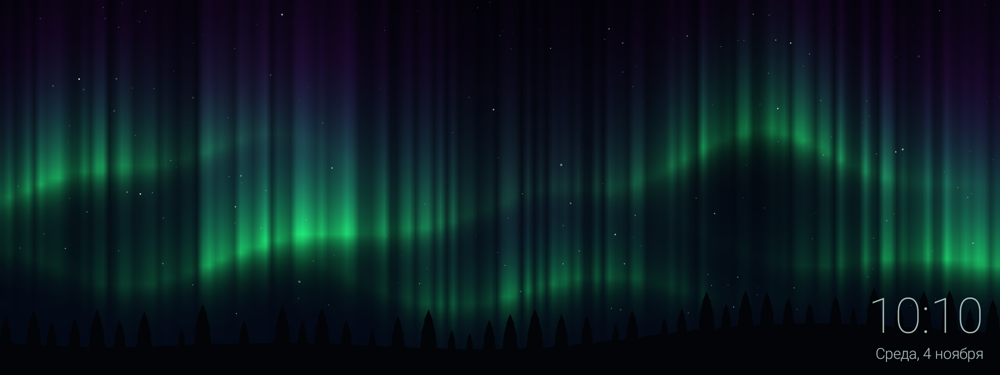

# Виджет «Заставка»

Полноэкранная заставка дашборда: когда экрана ГУ долго не касаются, поверх
виджетов плавно появляется анимированный фон, а подсветка окна приглушается.
Любое касание возвращает дашборд.

## Что делает

- Следит за бездействием, пока дашборд на экране и в фокусе.
- По истечении задержки накрывает дашборд выбранным фоном и снижает
  подсветку экрана ГУ до заданного уровня.
- Убирает фон по любому касанию. Касание, разбудившее заставку, виджетам не
  передаётся — оно только закрывает заставку.
- После пробуждения яркость возвращается, а отсчёт задержки начинается заново.

Заставка — это не системный screensaver и не выключение экрана. Приложение
рисует полноэкранный слой поверх своего окна и меняет подсветку экрана ГУ тем
же способом, что штатный ползунок яркости в шторке (через шину Desay SV).
Исходная яркость запоминается до пробуждения. Если приложение упадёт при
показанной заставке, яркость вернётся при следующем открытии дашборда. Если
за время заставки яркость поменяли штатным ползунком, приложение её не трогает.
Где шины Desay нет (эмулятор, другое ГУ), приглушается только яркость окна
(`screenBrightness`).

## Как добавить

1. Войти в режим редактирования (кнопка с сеткой на боковой панели).
2. Нажать «+ Добавить блок».
3. Выбрать «Заставка». Плитка появится на сетке.

Плитка сама по себе ничего не показывает: это переключатель.

| Состояние | Как выглядит | Что делает |
| --- | --- | --- |
| Включена | Цветная иконка-пейзаж | Заставка включается по простою |
| Выключена | Серая полупрозрачная иконка | Заставка не включается |

Тап по плитке включает и выключает заставку. Настройки открываются
шестерёнкой на плитке в режиме редактирования.

## Настройки

| Параметр | Значения | По умолчанию |
| --- | --- | --- |
| Задержка | 30 с, 1, 2, 3, 5, 10, 15 или 30 мин | 1 мин |
| Яркость | уровень 1–10, как у штатного ползунка ГУ | 2 |
| Фон заставки | «Тёмный с часами», «Камин», «Северное сияние» | «Тёмный с часами» |
| Менять фон по кругу | вкл / выкл | выкл |
| Смена фона | 30 с, 1, 3, 5 или 10 мин | 1 мин |

Яркость действует, пока показана заставка. ГУ хранит яркость для дня и для
ночи отдельно; заставка меняет ту, что активна сейчас. Старое значение в
процентах (до версии 1.8.2) переносится автоматически: 20 % → 2.

## Смена фонов по кругу

Если включить «Менять фон по кругу», заставка начнётся с выбранного фона,
а затем каждые N секунд («Смена фона») будет плавно переходить к следующему
по порядку: «Тёмный с часами» → «Камин» → «Северное сияние» → снова
«Тёмный с часами». Смена идёт, только пока заставка на экране; после
касания и нового показа отсчёт начинается с выбранного фона.

Выбранный в «Фоне заставки» вариант задаёт первый фон и точку, с которой
начинается круг.

## Фоны

### Тёмный с часами

Чёрный экран и крупные приглушённые часы с датой. Раз в ~15 секунд надпись
плавно гаснет и появляется в другом месте экрана — так экран не выгорает и
картинка не выглядит застывшей.

### Камин

Живое пламя на чёрном фоне с отражением в глянцевой поверхности. Часы и дата
находятся в правом нижнем углу.

### Северное сияние

Ночное небо с мерцающими звёздами: они плавно гаснут и вспыхивают, у самых
ярких на пике появляется мягкий ореол и короткие лучи-крестик. По небу
медленно колышутся зелёно-фиолетовые полосы сияния, внизу — силуэт хвойного
леса, изредка пролетает падающая звезда. Часы и дата — в правом нижнем углу.

## Поведение и ограничения

- Заставка не появляется в режиме редактирования, в том числе когда открыты
  настройки виджета: после выхода из редактирования отсчёт начинается заново.
- Таймер работает, только пока окно дашборда в фокусе. Если приложение ушло
  на второй план, заставка не показывается.
- Если на дашборде несколько плиток «Заставка», используется настройка первой
  добавленной. Достаточно одной плитки.
- Когда заставка показана, касания к вырезу блока навигатора тоже
  перехватываются, чтобы случайный тап не ушёл в карту под заставкой.
- Заставка не гасит экран и не удерживает его включённым: это фон окна
  приложения, а не системная блокировка.

## Для разработчиков

- `app/src/main/java/com/dash/headunit/screensaver/Screensaver.kt` — таймер,
  показ/скрытие слоя, яркость, список фонов и значения настроек.
- `app/src/main/java/com/dash/headunit/car/HuBrightness.kt` — подсветка ГУ
  через Desay: чтение (5,1), запись как у штатного ползунка, `dim`/`undim`
  для заставки (исходные значения — в prefs `hu_brightness`).
- `SaverView.kt` — общая основа анимированных фонов.
- `DarkClockView.kt`, `FireplaceView.kt`, `AuroraView.kt` — три фона.
- `app/src/main/java/com/dash/headunit/widgets/ScreensaverWidgetView.kt` —
  плитка-переключатель.
- Настройки хранятся в `WidgetSettingsStore` как опции `ss_timeout_s`,
  `ss_level` (уровень 1–10; старое `ss_brightness` в % — только для переноса),
  `ss_background`, `ss_rotate`, `ss_rotate_s`, `ss_enabled`
  (с префиксом id плитки).

См. также [README](../README.md) и [CHANGELOG](../CHANGELOG.md).
