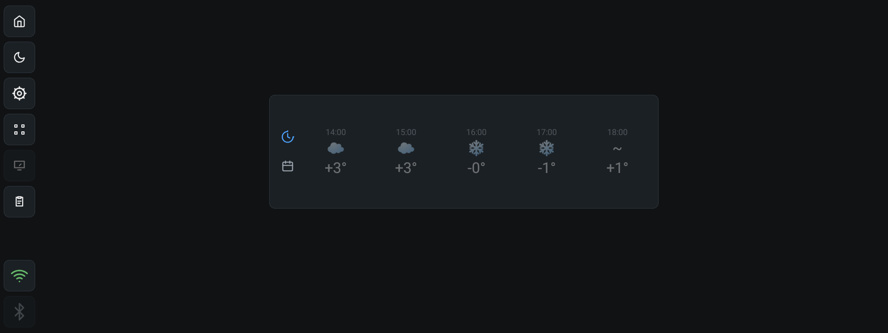
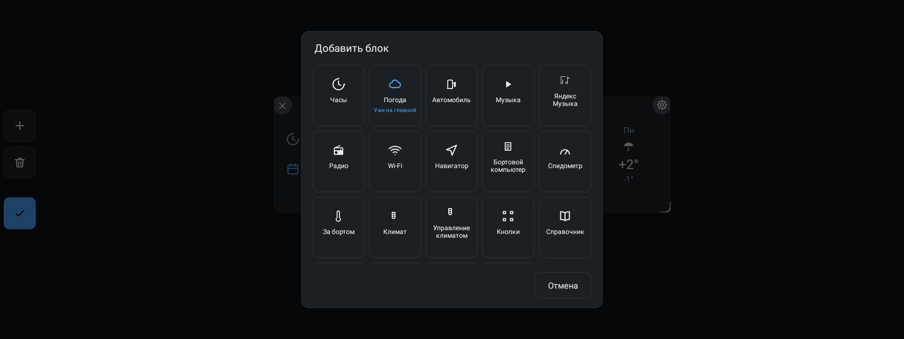
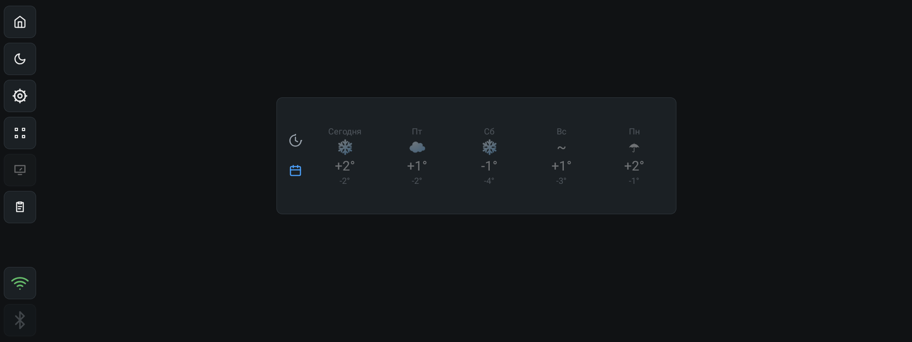
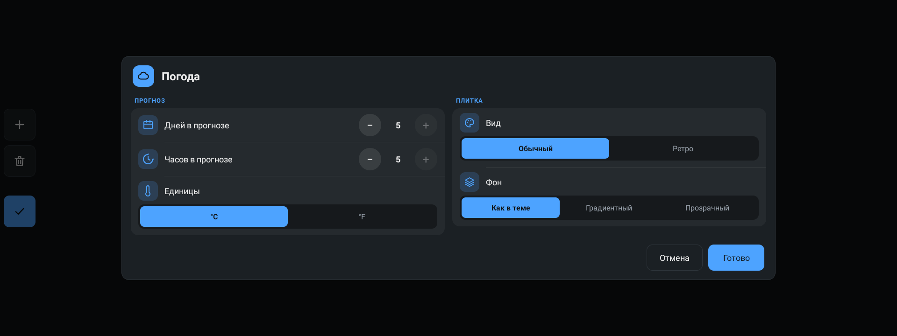
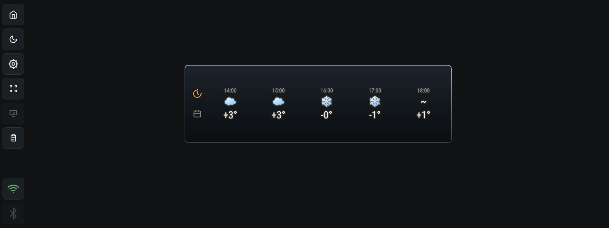
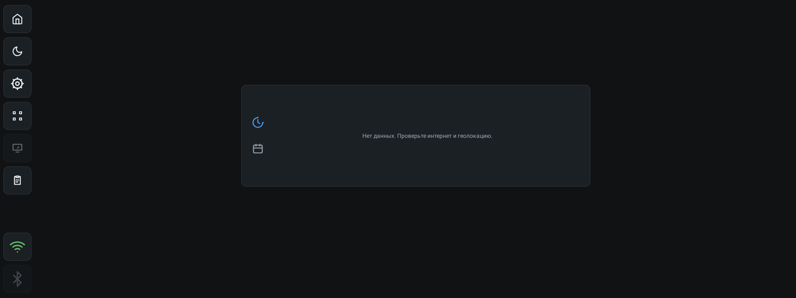

# Виджет «Погода»

Полоса прогноза погоды: слева две иконки-переключателя (часы и календарь),
справа — колонки прогноза. По часам показывает время, значок погоды и
температуру, по дням — день недели, значок, максимум и минимум. Данные
общие для всех плиток «Погода» на дашборде: один запрос обслуживает их все.

## Что делает

- Показывает прогноз по часам (от текущего) и по дням (сегодня и следующие).
- Слева — рейка с двумя кнопками: часы и календарь. Активная вкладка
  подсвечена цветом темы, вторая — приглушённым.
- Обновляет прогноз сам каждые 30 минут и по тапу на плитку.
- Берёт координаты с устройства; если геолокация недоступна — считает погоду
  по координатам Москвы.
- Если интернета нет, показывает последний удачный прогноз из кэша.

## Как добавить

1. Войти в режим редактирования (кнопка с сеткой на боковой панели).
2. Нажать «+ Добавить блок».
3. Выбрать «Погода». Плитка появится на сетке.

Плитку можно растягивать и сжимать за правый нижний угол: колонки прогноза
перестраиваются под ширину блока.

## Два вида прогноза

### По часам

Колонки идут от текущего часа. В каждой сверху время («14:00»), под ним
значок погоды, под ним — температура. Сколько колонок показывать —
настраивается (1–5).

### По дням

Первый день подписан «Сегодня», остальные — коротким днём недели («Пт»).
Под значком — максимум дня (крупно) и минимум (мельче, приглушённым).

## Настройки

| Параметр | Значения | По умолчанию |
| --- | --- | --- |
| Дней в прогнозе | 1–5 | 3 |
| Часов в прогнозе | 1–5 | 3 |
| Единицы | °C, °F | °C |
| Вид | «Обычный», «Ретро» | «Обычный» |
| Фон | «Как в теме», «Градиентный», «Прозрачный» | «Как в теме» |

Температура показывается всегда со знаком: «+3°», «−1°», в °F — «+37°F».
Вкладка (часы или дни) не сохраняется: после пересборки виджета, например
после сохранения настроек, снова открываются часы.

Вид «Ретро» — общий для всех виджетов: чёрная табличка в металлической рамке,
узкий шрифт с ореолом.

## Обновление

- Автообновление — каждые 30 минут, пока приложение запущено. Цикл живёт в
  процессе приложения: после перезапуска прогноз подтягивается заново.
- Ручное обновление — тап по самому прогнозу (не по иконкам слева). Пока идёт
  запрос, прежние данные приглушаются; в конце — короткое сообщение
  «Погода обновлена» или «Не удалось обновить погоду».
- Пока идёт загрузка, повторный тап игнорируется.
- Последний удачный прогноз сохраняется в кэш и показывается сразу при
  запуске, пока свежие данные ещё не пришли.

## Откуда берутся данные

| Источник | Когда используется | Ключ API |
| --- | --- | --- |
| Open-Meteo | основной, если ключ OpenWeatherMap не задан | не нужен |
| OpenWeatherMap | если ключ задан; при сбое — откат на Open-Meteo | бесплатный тариф |
| Кэш | если сеть недоступна | — |

Ключ OpenWeatherMap кладётся в `local.properties` как `openweathermap.key=...`
(см. `local.properties.example`) — в репозитории он не хранится.

Координаты берутся с устройства напрямую через `LocationManager`, без Google
Play Services: сначала свежая last-known точка (не старше 30 минут), иначе
разовый запрос с таймаутом 15 секунд. При запуске приложение спрашивает
разрешение на доступ к геолокации, если его ещё не выдали. Если разрешения
нет или провайдеры выключены, погода считается по координатам Москвы
(55.7558, 37.6173) — об этом виджет не предупреждает.

## Значки

Значок — обычный символ Unicode, а не цветная картинка: шрифты штатных ГУ
часто не содержат эмодзи. Состояние определяется по кодам WMO.

| Код | Состояние | Значок |
| --- | --- | --- |
| 0 | Ясно | ☀ |
| 1 | Преимущественно ясно | ☀ |
| 2 | Переменная облачность | ⛅ |
| 3 | Пасмурно | ☁ |
| 45, 48 | Туман | ~ |
| 51–57 | Морось, ледяная морось | ☂ |
| 61–67 | Дождь, ледяной дождь | ☂ |
| 71–77, 85, 86 | Снег, снежная крупа, снегопад | ❄ |
| 80–82 | Ливень | ☂ |
| 95–99 | Гроза, гроза с градом | ⚡ |

Коды OpenWeatherMap переводятся в WMO, поэтому виджет работает одинаково с
обоими источниками.

## Поведение и ограничения

- Виджет показывает только значок: название города, текущая температура «прямо
  сейчас» и текстовое состояние погоды в нём не выводятся, хотя приходят от
  API.
- Погода общая для всех плиток «Погода» на дашборде — запрос один на всех.
  Настройки (дни, часы, единицы) у каждой плитки свои.
- Число часов и дней, которые виджет показывает, задаётся настройкой (1–5).
  Из сети приложение забирает до 5 часов и 5 дней.
- С Open-Meteo почасовка идёт по часу, с OpenWeatherMap — с шагом 3 часа
  (такая сетка у этого API). Время в колонках — местное время точки прогноза.
- Без интернета и без кэша виджет пишет «Нет данных. Проверьте интернет и
  геолокацию.» Тап по прогнозу в этом случае повторяет попытку.

## Для разработчиков

- `app/src/main/java/com/dash/headunit/widgets/ForecastStripView.kt` — вид:
  рейка с переключателями, колонки часов и дней, ручное обновление по тапу.
- `app/src/main/java/com/dash/headunit/weather/WeatherHub.kt` — общий источник
  данных на процесс: состояние, подписчики, автоцикл 30 минут.
- `app/src/main/java/com/dash/headunit/weather/WeatherRepository.kt` — выбор
  источника (OpenWeatherMap → Open-Meteo) и кэш в prefs `weather_prefs`
  (ключ `cache_v1`).
- `app/src/main/java/com/dash/headunit/weather/OpenMeteoClient.kt` — основной
  клиент: `current` + `hourly` + `daily`, отдельный reverse-geocode города.
- `app/src/main/java/com/dash/headunit/weather/OwmClient.kt` — запасной клиент
  (`/weather` + `/forecast`), перевод кодов OWM в WMO (`owmToWmo`).
- `app/src/main/java/com/dash/headunit/weather/WmoCodes.kt` — WMO-код →
  русское название и символ.
- `app/src/main/java/com/dash/headunit/weather/WeatherModels.kt` — модели:
  `HourlyPoint`, `DailyPoint`, `WeatherData`.
- `app/src/main/java/com/dash/headunit/location/LocationHelper.kt` — координаты
  без Google Play Services, fallback — Москва.
- Настройки хранятся в `WidgetSettingsStore` как `days`, `hours` и `unit`
  (с префиксом id плитки) плюс общие `opt_look` и `opt_bg`.
- Ключ OpenWeatherMap попадает в `BuildConfig.OPENWEATHER_KEY` из
  `local.properties`.
- Тесты разбора ответов API: `app/src/test/java/com/dash/headunit/weather/`
  (`OpenMeteoClientTest.kt`, `OwmClientTest.kt`).

См. также [README](../README.md) и [CHANGELOG](../CHANGELOG.md).
